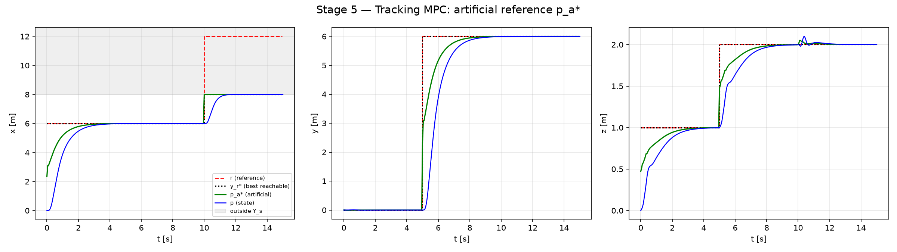
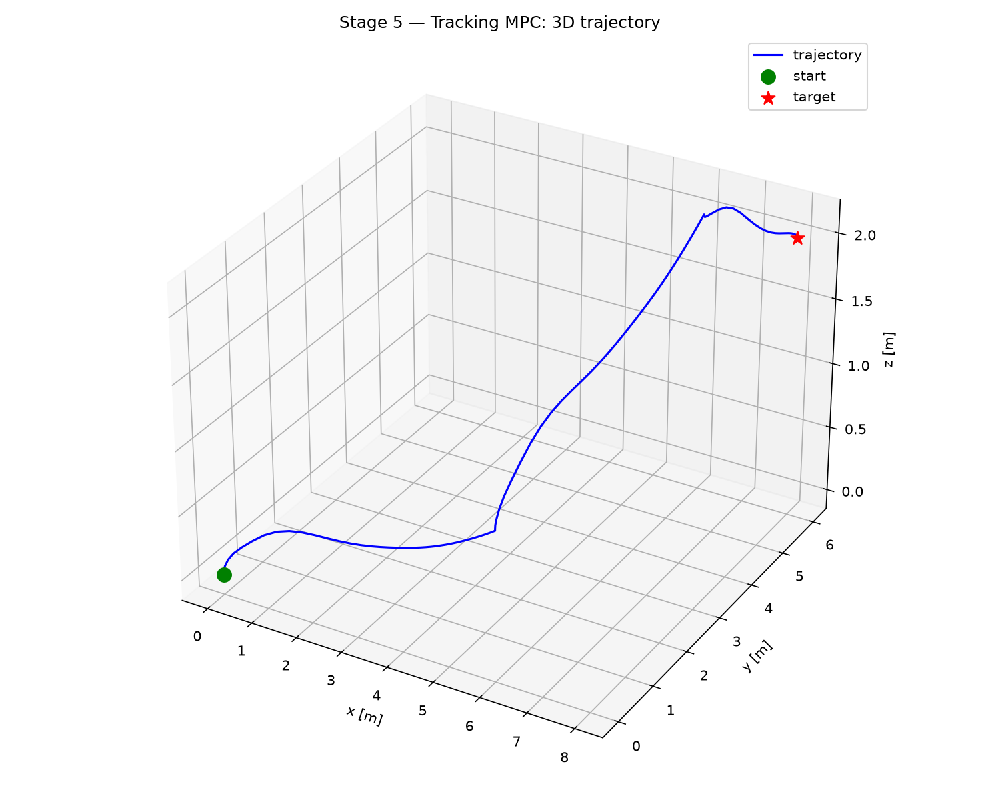
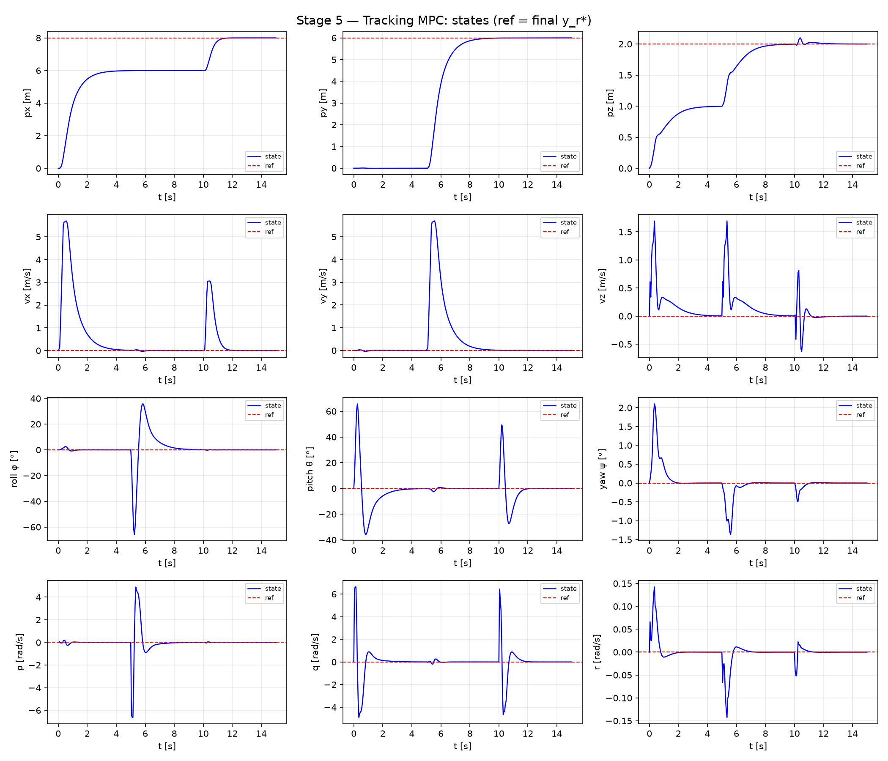
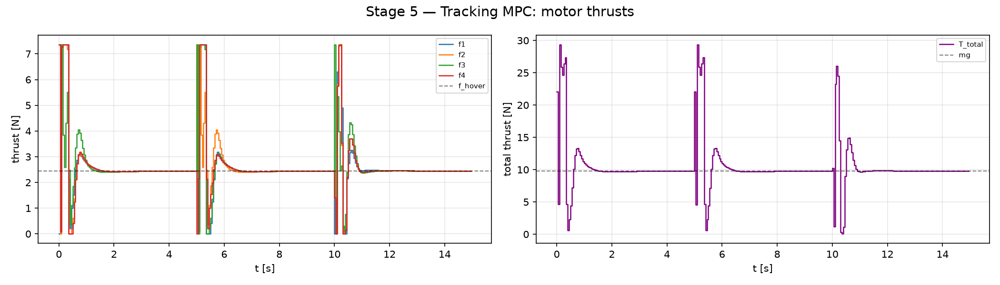

# Stage 5 — Tracking NMPC with Artificial Reference

Stages 1–4 regulate the quadrotor to **one fixed hover point** that is known to be reachable. This
stage drops that assumption. The controller receives a **piece-wise constant reference** $r(t)$ that
may jump by metres, and may even lie outside the admissible region. The tracking MPC of
Limon et al. (2018) stays recursively feasible for *any* such reference and drives the quadrotor to
the **closest admissible steady state**.

> D. Limon, A. Ferramosca, I. Alvarado, T. Alamo, "Nonlinear MPC for tracking piece-wise constant
> reference signals," *IEEE Transactions on Automatic Control* 63(11), 2018.
> [doi:10.1109/TAC.2018.2798803](https://doi.org/10.1109/TAC.2018.2798803)

This stage practices the tracking MPC on the **nominal plant**: full state feedback, no disturbance,
no estimator.

| | |
|---|---|
| Model / plant | nominal quadrotor, `create_tracking_model()` / `create_disturbance_plant()` with $d = 0$ |
| Horizon | $N = 20$, $T = 1$ s, $T_s = 0.05$ s |
| Solver | acados `SQP_RTI`, `PARTIAL_CONDENSING_HPIPM`, Gauss-Newton, ERK4 |
| Scenario | three reference jumps at $t = 0, 5, 10$ s, the last one outside the room |
| Entry point | `./run.sh simulate_tracking.py` → `results/stage5_tracking/` |

---

## 1. Why regulation MPC is not enough

Take the regulation OCP of Stages 1–2 with the reference $r$ as terminal target, $x_N = x_r$:

- If $r$ is **far away**, the quadrotor cannot reach and stop at $r$ within the 1 s horizon with
  thrusts limited to $0 \le f_i \le 3 f_{\text{hover}}$. The OCP is **infeasible**.
- If $r$ **changes**, the terminal constraint moves with it, so feasibility of the previous solution
  says nothing about the new problem. Recursive feasibility is lost at every jump.
- If $r$ is **outside the admissible set** (here: outside the room), no steady state exists at all
  and the OCP is infeasible for every initial state.

Soft terminal constraints hide the problem instead of solving it. The tracking formulation changes
*where the reference enters*.

## 2. Theory: tracking with an artificial reference

### Steady states and their parametrization

For the plant $x^+ = f(x, u)$ every admissible steady state $(x_s, u_s)$ with $x_s = f(x_s, u_s)$
is parametrized by an output $y_s$ through a map $g$:

```math
(x_s,\, u_s) = g(y_s), \qquad y_s \in \mathcal{Y}_s .
```

### The OCP

The MPC does not steer to $r$. It **optimizes an artificial reference** $y_a$ together with the
inputs, and steers to the steady state belonging to $y_a$:

```math
\begin{aligned}
\min_{u(\cdot),\, y_a} \quad & \sum_{k=0}^{N-1} \ell\big(x_k - x_a,\; u_k - u_a\big) \;+\; V_o(y_a - r)
\\ \text{s.t.} \quad & x_{k+1} = f(x_k, u_k), \quad x_0 = x(t)
\\ & (x_k, u_k) \in \mathcal{Z}
\\ & (x_a, u_a) = g(y_a), \quad y_a \in \mathcal{Y}_s
\\ & x_N = x_a
\end{aligned}
```

Two ingredients carry the whole theory:

- **$r$ appears only in the cost $V_o$, never in a constraint.** Changing $r$ changes the objective
  but not the feasible set. The OCP stays feasible after any reference change.
- **The terminal constraint is $x_N = x_a$, not $x_N = r$.** The artificial reference is a steady
  state by construction, so the shifted solution (previous inputs followed by $u_a$) is always
  feasible at the next step. This gives recursive feasibility for arbitrary reference sequences.

### Optimal reachable reference

The offset cost $V_o$ is positive definite and strictly convex, and $\mathcal{Y}_s$ is convex and
compact, so the closest admissible steady state is unique:

```math
y_r^\ast = \arg\min_{y \in \mathcal{Y}_s} V_o(y - r).
```

If $r \in \mathcal{Y}_s$ then $y_r^\ast = r$. Otherwise $y_r^\ast$ is the projection of $r$ onto
$\mathcal{Y}_s$. Under the assumptions of Limon et al. (2018) the closed loop converges to the steady
state $g(y_r^\ast)$ — the optimal reachable one — and not merely to *some* steady state.

> **Scope of this implementation.** The guarantees assume the OCP is solved to optimality.
> Closed-loop runs use a single `SQP_RTI` iteration per step, and the theory is not re-verified
> for every assumption (e.g. the chosen terminal equality, see §3). The statements in §5 are
> therefore *observed* behaviour of this implementation. `create_solver(nlp_solver='SQP')`
> iterates to convergence if the exact-solution behaviour is needed as a reference.

## 3. Implementation

### Choices for the quadrotor

| Ingredient | Choice |
|---|---|
| Artificial reference $y_a$ | hover position $p_a \in \mathbb{R}^3$ (yaw fixed at 0) |
| Steady-state map $g(p_a)$ | $`x_a = [p_a,\; v = 0,\; q = [1,0,0,0],\; \omega = 0]`$, $u_a = f_{\text{hover}} \cdot \mathbf 1$ |
| Admissible set $\mathcal{Z}$ | $0 \le f_i \le F_{\max}$ and room walls $`\pm[8.5,\, 8.5,\, 3.5]`$ m on $p$ |
| Steady-state set $\mathcal{Y}_s$ | room shrunk by 0.5 m: $[-8,8] \times [-8,8] \times [-3,3]$ m |
| Offset cost | $V_o = \lVert p_a - r \rVert^2_T$, $T = \mathrm{diag}(50, 50, 50)$ |

- $g$ is affine in $p_a$, hence Lipschitz with constant 1. It is implemented **once**
  (`steady_state_map` in `quadrotor_3d_model.py`) and accepts NumPy or CasADi input, so the OCP and
  the simulation cannot disagree on it.
- Every hover point is a steady state, and $f_{\text{hover}} = F_{\max}/3$ lies strictly inside
  $[0, F_{\max}]$. Shrinking the room by `MARGIN = 0.5` m makes every steady state in $\mathcal{Y}_s$
  **strictly** inside $\mathcal{Z}$ — the usual requirement that $\mathcal{Y}_s$ stays away from
  the constraint boundary.
- Because $V_o$ is a weighted squared norm and $\mathcal{Y}_s$ is a box, $y_r^\ast$ is the
  component-wise clip of $r$ onto the box when $T$ is diagonal
  (`optimal_reachable_reference`). The plots use it as the theoretical end point.

### Mapping to acados

acados has no decision variable shared by all shooting nodes. The artificial reference is therefore
added as a **state with zero dynamics**:

```math
\tilde x = \begin{bmatrix} x \\ p_a \end{bmatrix} \in \mathbb{R}^{16}, \qquad
\dot x = f(x, u), \quad \dot p_a = 0 .
```

Only $x$ is fixed at node 0 (`idxbx_0 = 0..12`). $p_a$ stays free there and the dynamics copy it
unchanged to every node, which is exactly one decision variable $p_a$.

| Theory | acados |
|---|---|
| $`\ell(x - x_a,\, u - u_a)`$ | `NONLINEAR_LS` stage cost on $`[x - x_a(p_a);\; u - u_a]`$, `yref = 0` |
| $V_o(y_a - r)$ | `NONLINEAR_LS` terminal cost on $p_a - r$, $r$ is a runtime parameter `model.p` |
| $x_N = x_a$ | linear terminal constraint $C_e \tilde x_N = 0$ ($x_a$ is linear in $p_a$) |
| $y_a \in \mathcal{Y}_s$ | box bounds on the $p_a$ states (constant, so enforced on nodes 1…N−1) |
| $(x_k, u_k) \in \mathcal{Z}$ | thrust bounds; position bounds on nodes 1…N−1 |
| $r$ | cost parameter only, set at every node by `set_reference` |

**Terminal equality on 12 of 13 states.** `IDX_TERM_EQ` leaves out $q_w$. The dynamics keep
$\lVert q \rVert = 1$, so with $q_x = q_y = q_z = 0$ fixed, $q_w = 1$ follows. Constraining all four
quaternion entries gives four rows of rank 3, which violates LICQ and makes HPIPM struggle.

**Cost scaling.** acados multiplies the stage cost by $T_s$ and the terminal cost by 1. The effective
ratio between tracking cost and offset cost is therefore $T_s Q : T_{\text{off}}$, e.g. $0.05 \cdot 80 = 4$ against
$50$ for the horizontal position. `T_OFFSET` is tuned with this ratio in mind: the larger it is,
the faster $p_a^\ast$ moves toward $r$ and the more aggressive the flight becomes.

**Warm start.** `init_guess` starts at rest with $p_a$ = current position and $u = u_a$. Hovering
where you are is a feasible steady state, so the first OCP is trivially feasible.

**Failure handling.** In `simulate_tracking.py` a failed solve (`status ≠ 0`) is counted. Its first
input is still applied, clipped to the motor limits, with hover thrust as fallback if the input is
not finite.

### Weights (stage cost, identical to Stage 2)

| | $p_{x,y}$ | $p_z$ | $v_{x,y}$ | $v_z$ | $q_w$ | $q_x, q_y$ | $q_z$ | $\omega$ | $u$ |
|---|---|---|---|---|---|---|---|---|---|
| weight | 80 | 120 | 10 | 15 | 10 | 120 | 80 | 1 | 0.1 |

## 4. Scenario

The quadrotor starts hovering at the origin and flies this reference sequence on the nominal plant:

| $t$ [s] | $r$ [m] | Purpose |
|---|---|---|
| 0 | (6, 0, 1) | 6 m jump — not reachable within one 1 s horizon |
| 5 | (6, 6, 2) | second jump, new direction |
| 10 | (12, 6, 2) | $x = 12$ is **outside the room** → no admissible steady state at $r$ |

For the last reference, $\mathcal{Y}_s$ ends at $x = 8$, so the expected end point is the projection
$`y_r^\ast = (8,\, 6,\, 2)`$ m.

## 5. Results

All figures are in `results/stage5_tracking/`. Values below are read from the plots.

### 5.1 The artificial reference



- **$p_a^\ast$ does not jump to $r$.** At $t = 0$ it starts at roughly (2.3, 0, 0.5) m, between the
  position $p$ and $r$. The optimizer picks a hover point from which the quadrotor can still stop
  inside the horizon, and balances this against the offset cost. This is what keeps the first
  OCP feasible for a 6 m jump.
- **$p_a^\ast$ slides toward $r$**, reaching it within about 3–4 s per leg, and **$p$ follows
  $p_a^\ast$** with a lag of roughly 1 s. After reaching the reference, $p_a^\ast$ and $p$ coincide
  with $r$ with no visible offset.
- **At $t = 5$ s** the $y$ and $z$ components of $p_a^\ast$ move up immediately (to ≈ 3 m and
  ≈ 1.5 m) and then slide on toward 6 m and 2 m. The $x$ component is unaffected.
- **At $t = 10$ s the reference $x = 12$ m is outside the room.** $p_a^\ast$ jumps at once to
  $x = 8$ m and stays there. This is the boundary of $\mathcal{Y}_s$ (room 8.5 m minus margin 0.5 m)
  and coincides with the dotted $y_r^\ast$ curve. $p$ settles at 8 m, 0.5 m away from the
  walls at 8.5 m, and the OCP remains feasible although $r$ itself is inadmissible.

The closed loop therefore converges to $`y_r^\ast = (8,\, 6,\, 2)`$ m. The exact end-point error
$\lVert p_\text{end} - y_r^\ast \rVert$ and the number of failed OCP calls are printed by
`summarize()` at the end of every run.

### 5.2 Flight path

<p align="center">
  
</p>

A smooth path from the origin to (8, 6, 2) m. The bends mark the reference switches at 5 s and
10 s. The star shows the final $y_r^\ast$, not the last $r$.

### 5.3 States



| Leg | Peak speed | Attitude | Peak body rate |
|---|---|---|---|
| 0 → 5 s, $x$: 6 m | $v_x \approx 5.7$ m/s | pitch ≈ +65° then ≈ −35° | $q \approx 6.6$ rad/s |
| 5 → 10 s, $y$: 6 m | $v_y \approx 5.7$ m/s | roll ≈ −65° then ≈ +35° | $p \approx -6.5$ / $+4.9$ rad/s |
| 10 → 15 s, $x$: 2 m | $v_x \approx 3$ m/s | pitch ≈ +50° then ≈ −27° | $q \approx 6.5$ rad/s |

- Each leg is a tilt–accelerate–tilt-back–brake maneuver: positive pitch accelerates along $+x$,
  negative roll along $+y$. All states return to rest at the end of each leg.
- Yaw stays below ≈ 2° and $r$ below 0.15 rad/s although yaw is not constrained.
- During the last leg $z$ overshoots to ≈ 2.1 m (≈ 0.1 m) because of the large tilt, then settles at 2 m.

### 5.4 Motor thrusts



At each reference jump (0, 5, 10 s) the thrusts hit **both limits**: $F_{\max} \approx 7.35$ N during
acceleration and 0 N during braking. Total thrust peaks at ≈ 29 N, which is $4 F_{\max}$, against
$mg = 9.81$ N. Between the jumps all four motors sit at $f_{\text{hover}} \approx 2.45$ N.
The saturated, bang-bang-like profile is what a 6 m reference jump with a heavily weighted offset
cost ($T = 50$) and no attitude or rate limits produces.

## 6. Observations and limitations

- **Aggressive flight.** Tilt angles up to ≈ 65° and body rates up to ≈ 6.6 rad/s are fully
  admissible in this stage because no attitude or rate constraint is active. For smoother flights
  lower `T_OFFSET` (slower $p_a^\ast$) or add tilt / rate bounds.
- **Nominal only.** There is no disturbance and no estimator. $g$ assumes $d = 0$, so
  $u_a = f_{\text{hover}} \mathbf 1$.
- **Position reference only.** Yaw is fixed to 0. Extending $y_a$ to $[p_a; \psi_a]$ is a change of
  $g$ and of the terminal equality.
- **RTI instead of full convergence.** See the scope note in §2.
- **Non-smooth $p_a^\ast$.** Small kinks in $p_a^\ast$ appear while the motors saturate (e.g. $z$ at
  $t \approx 0.3$ s). A likely cause is the single SQP iteration per step, but this was not isolated.

## Files

| File | Role |
|---|---|
| `ocp_config_tracking.py` | tracking OCP, runtime helpers, $\mathcal{Y}_s$, `optimal_reachable_reference` |
| `simulate_tracking.py` | closed loop, reference schedule, summary, figures |
| `quadrotor_3d_model.py` | `create_tracking_model()` ($\tilde x = [x; p_a]$), `steady_state_map()` $= g$, `IDX_TERM_EQ` |
| `plot_utils.py` | `plot_artificial_reference()` (new), the other plots are shared with Stages 1–4 |

```bash
./run.sh simulate_tracking.py          # → results/stage5_tracking/
QUAD_PLOTS=none ./run.sh simulate_tracking.py   # save only, no windows
```
