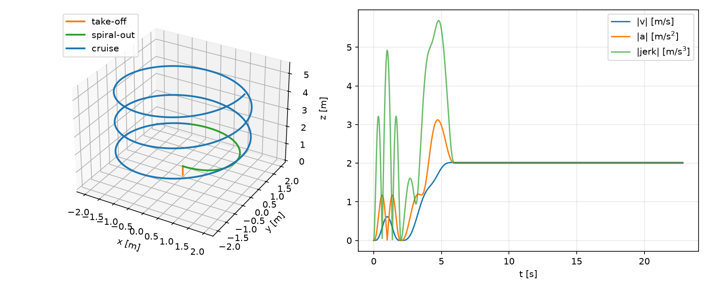
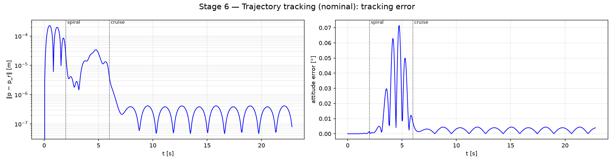
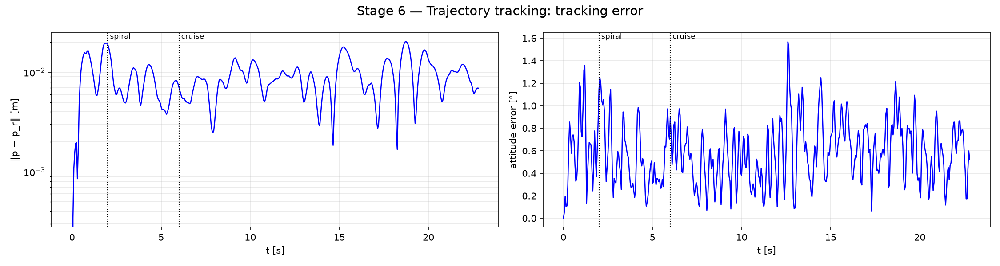
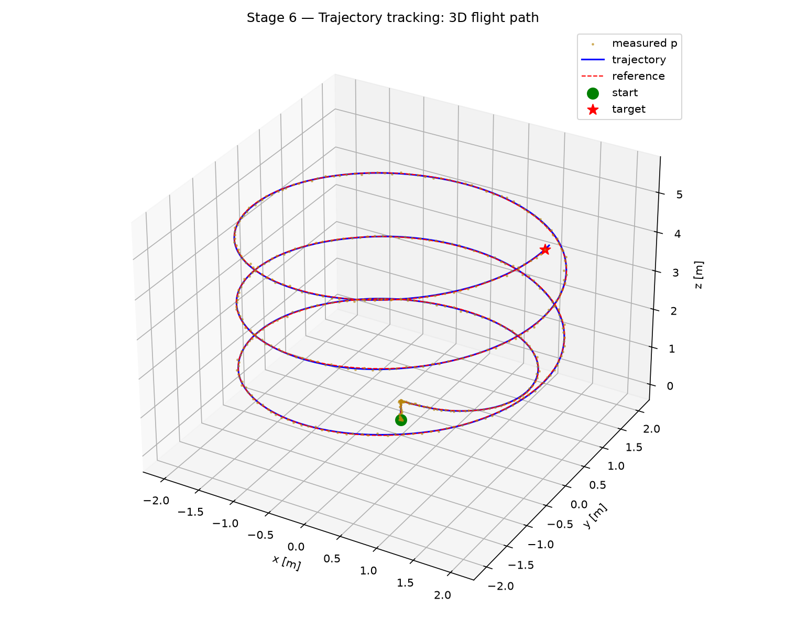
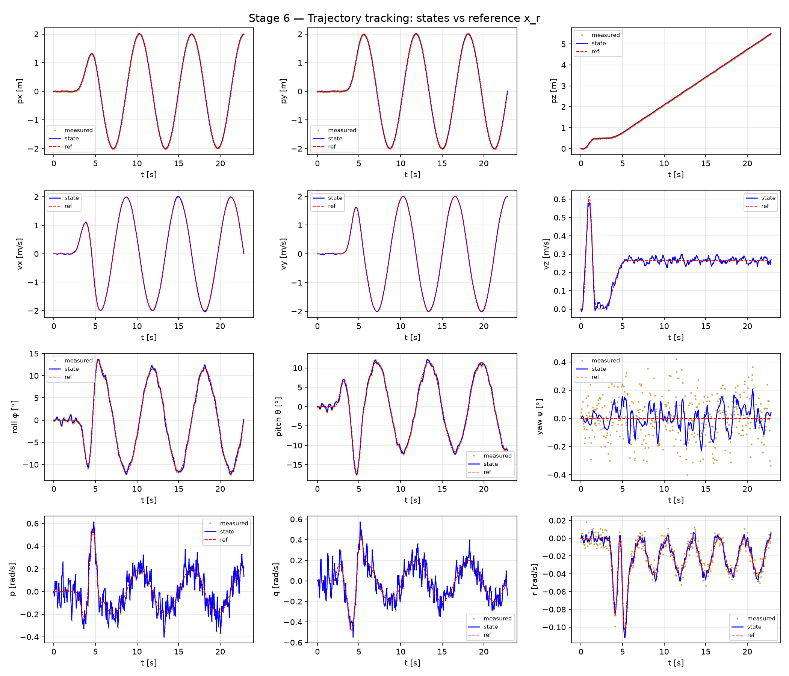
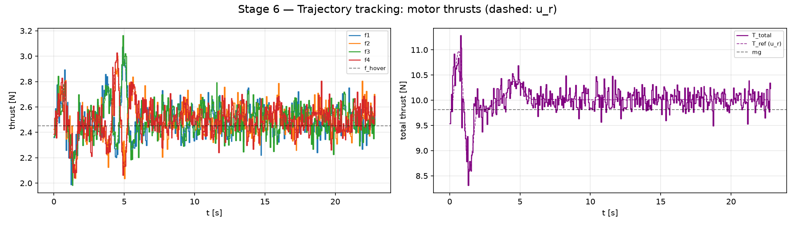
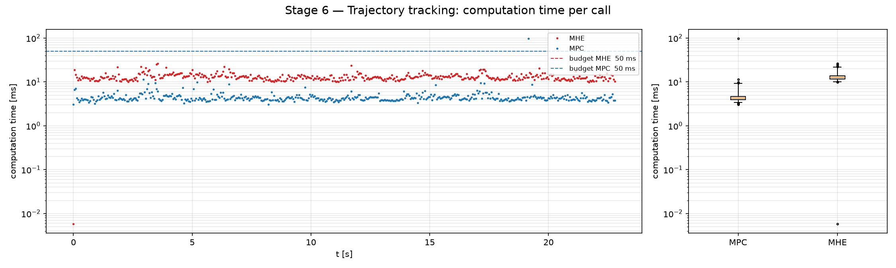

# Stage 6 — Trajectory-Tracking NMPC

Stages 1–5 steer the quadrotor to **steady states**: one hover point, or a sequence of hover points.
This stage tracks a **time-varying reference trajectory** — a climbing helix — where the quadrotor
never comes to rest. Two ingredients make this work:

- a **differential-flatness map** that turns the planned path $p_r(t)$ into a complete, dynamically
  consistent state and input reference $(x_r(t), u_r(t))$, and
- a **time-indexed reference in the OCP**: each node of the horizon gets its own trajectory point,
  instead of one set point for all nodes.

The main run flies the helix with the **Stage 4b measurement and estimator**: only noisy
$`y = [p;\, q;\, \omega]`$ is measured, and the certified Lyapunov MHE estimates the full state. A
second run (`--nominal`) verifies the controller alone with full state feedback.

| | |
|---|---|
| Model / plant | `create_disturbance_model()` (prediction, $d = \hat d$) / `create_disturbance_plant()`, no disturbance |
| Horizon | $N = 20$, $T = 1$ s, $T_s = 0.05$ s |
| Solver | acados `SQP_RTI`, `PARTIAL_CONDENSING_HPIPM`, Gauss-Newton, ERK4, shifted warm start |
| Reference | helix, $R = 2$ m, 5 m climb over 3 turns, 2 m/s, 22.85 s (`reference_generate.py`) |
| Estimator | certified Lyapunov MHE of Stage 4b, unchanged (`state_est_mhe.py`) |
| Entry point | `./run.sh simulate_trajectory.py [--nominal]` → `results/stage6_trajectory/` |

---

## 1. From a set point to a trajectory

In the regulation OCPs of Stages 1–4 every node of the horizon is pulled toward the **same**
target $(x_s, u_s)$. For a moving reference this is wrong twice:

- **Timing.** Node $i$ predicts the state at $t + i T_s$. Its target must be the reference *at that
  time*, not at $t$. The reference becomes a stack of $N+1$ points that slides forward by one
  sample at every MPC call:

  | node | 0 | 1 | 2 | … | $N$ |
  |---|---|---|---|---|---|
  | target | $x_r(t)$ | $x_r(t + T_s)$ | $x_r(t + 2T_s)$ | … | $x_r(t + N T_s)$ |

- **Consistency.** A planner gives only the position $p_r(t)$ (and yaw). If the remaining entries
  were left at hover — $q_r = [1,0,0,0],$ $ \omega_r = 0, u_r = f_{\text{hover}}$ — the position
  cost would ask for a curved path while the attitude and input costs ask for level hover. The
  optimum is a compromise that lags behind the path. The full reference must be a **trajectory of
  the model**, so that the cost is zero *on* the reference and the MPC only corrects deviations.

The second point is what differential flatness provides.

## 2. Reference trajectory (`reference_generate.py`)

`HelixReference` generates the flat outputs analytically, together with all derivatives the
flatness map needs: position, velocity, acceleration, jerk and snap, plus yaw and its derivatives.

| Phase | Time | Motion |
|---|---|---|
| Take-off | 0–2 s | rest-to-rest hop from the origin to $(0, 0, 0.5)$ m |
| Spiral-out | 2–6 s | radius grows $0 \to R$, phase rate ramps $0 \to \omega$ |
| Cruise | 6 s on | constant-radius, constant-rate helix |

The helix itself is

```math
p_r(t) = \begin{bmatrix} r(t) \cos\theta(t) \\ r(t) \sin\theta(t) \\ 0.5 + k\, \theta(t) \end{bmatrix},
\qquad k = \frac{H}{2\pi n}, \quad H = 5 \text{ m}, \quad n = 3 ,
```

with $R = 2$ m and $\omega = 1$ rad/s, i.e. 2 m/s along the path and a climb rate of
$k\omega \approx 0.27$ m/s. The hop, the radius $r(t)$ and the phase rate $\dot\theta(t)$ all use
the degree-9 smoothstep $s(\tau) = 126\tau^5 - 420\tau^6 + 540\tau^7 - 315\tau^8 + 70\tau^9$,
whose first four derivatives vanish at both ends. Position, velocity, acceleration, jerk and
snap are therefore **continuous at every phase boundary** — the flatness map needs snap for the
motor thrusts (§3), and a jump in snap would be a jump in $u_r$.

<p align="center">
  
</p>

| Peak speed | Peak acceleration | Peak tilt | Peak thrust / mass | Final height |
|---|---|---|---|---|
| 2.02 m/s | 3.12 m/s² | 17.5° | 10.98 N/kg | 5.5 m |

The acceleration peaks at the end of the spiral-out, where the radius and the phase rate are both
still growing. In cruise $\lvert a \rvert = R\omega^2 = 2$ m/s², pointing to the helix axis.

`python reference_generate.py` runs a self-test: rest at $t = 0$, continuity up to snap at both
junctions, and the analytic derivative chain against central differences.

## 3. Differential flatness (`reference_flatness.py`)

The quadrotor is **differentially flat** with the flat output $`\sigma = [p;\, \psi]`$: every state
and every input can be written as an algebraic function of $\sigma$ and finitely many of its time
derivatives, without integration (Mellinger & Kumar, 2011). The map is built by walking the
equations of motion backwards, one derivative per step:

**1. Thrust vector** (from acceleration). Translational dynamics, $m\dot v = T R e_3 - m g e_3 + d_f$:

```math
f = m\,(a + g e_3) - d_f, \qquad T = \lVert f \rVert, \qquad z_B = f / \lVert f \rVert .
```

**2. Attitude** (from yaw). $z_B$ fixes two rotational degrees of freedom, the yaw $\psi$ the
third. In the ZYX convention of `quat_to_euler`:

```math
y_C = \begin{bmatrix} -\sin\psi \\ \cos\psi \\ 0 \end{bmatrix}, \qquad
x_B = \frac{y_C \times z_B}{\lVert y_C \times z_B \rVert}, \qquad
y_B = z_B \times x_B, \qquad
R = [\,x_B \;\; y_B \;\; z_B\,] \;\to\; q_r .
```

**3. Body rates** (from jerk). Differentiating steps 1–2 once gives $\dot R$, and

```math
[\omega_r]_\times = R^\top \dot R .
```

**4. Angular acceleration and torque** (from snap). Differentiating twice gives $\ddot R$. The
skew-symmetric part of $`R^\top \ddot R = [\omega]_\times^2 + [\alpha]_\times`$ is $`[\alpha]_\times`$, and
Euler's equation gives the torque:

```math
\tau = I \alpha + \omega \times I\omega - d_\tau .
```

**5. Motor thrusts.** Invert the mixer: $`u_r = \mathrm{MIXER}^{-1}\,[T;\; \tau]`$.

The result is $`x_r = [p_r,\, v_r,\, q_r,\, \omega_r]`$ and $u_r$ — **exactly** a trajectory of the
prediction model. The disturbance estimate $\hat d$ enters steps 1 and 4, so under a disturbance
the reference tilts and the thrusts change such that the helix is still flown by
$f(x, u, \hat d)$.

**Verification.** `python reference_flatness.py` flies $u_r(t)$ **open loop** through the CasADi
model (RK4, 2 ms) and compares the result with $x_r(t)$:

| Case | max position error | max attitude error |
|---|---|---|
| no disturbance | $5 \cdot 10^{-9}$ m | $2 \cdot 10^{-6}$ ° |
| disturbance, $\hat d = d$ | $4 \cdot 10^{-9}$ m | $2 \cdot 10^{-6}$ ° |
| disturbance, $\hat d = 0$ (control case) | 2400 m | 180° |

The control case shows that the test is sensitive to $d$. Along the helix the reference stays well
inside the envelope: $`\lvert\omega_r\rvert \le (0.54,\, 0.48,\, 0.10)`$ rad/s and
$`u_r \in [2.16,\, 3.00]`$ N against $`[0,\, 7.36]`$ N.

**Role in the loop.** The flatness map is a **reference generator**, not feedback: it reads the
clock $t$ (and $\hat d$), never the measured state. It runs at every MPC call over the $N+1$
horizon times; it could equally be tabulated offline.

Singularities, not reached by the helix: free fall ($\lVert f \rVert = 0$, $z_B$ undefined) and
$z_B \parallel y_C$ (90° pitch, $x_B$ undefined).

## 4. Tracking OCP (`ocp_config_trajectory.py`)

```math
\begin{aligned}
\min_{u_0, \dots, u_{N-1}} \quad & \sum_{i=0}^{N-1} \Big( \lVert e(x_i, x_{r,i}) \rVert_Q^2 + \lVert u_i - u_{r,i} \rVert_R^2 \Big) \;+\; \lVert e(x_N, x_{r,N}) \rVert_P^2
\\ \text{s.t.} \quad & x_{i+1} = f(x_i, u_i, \hat d), \qquad x_0 = \hat x(t)
\\ & 0 \le u_i \le F_{\max}, \qquad \lvert \omega_i \rvert \le 0.9\, \omega_{\max} \;\; \text{(soft)}
\\ & x_{r,i} = x_r(t + i T_s), \qquad u_{r,i} = u_r(t + i T_s)
\end{aligned}
```

### State error

`state_error(x, x_r)` returns the 12-dimensional error

```math
e(x, x_r) = \begin{bmatrix} p - p_r \\ v - v_r \\ \mathrm{vec}(q \otimes q_r^{-1}) \\ \omega - \omega_r \end{bmatrix} .
```

The attitude part is the vector part of the error quaternion, computed with `quat_error_casadi`
from `quadrotor_3d_model.py` (the same function the MHE cost uses). For a rotation by $\theta$
about the axis $n$ it equals $`\sin(\theta/2)\, n`$, i.e. half the small-angle rotation vector.
Compared with the component difference $q - q_r$ of Stages 1–5:

- it is exact for any reference attitude — the reference is tilted all the time here;
- it has three entries, so no weight on $q_w$ is needed;
- $\lVert \mathrm{vec}(q \otimes q_r^{-1}) \rVert^2 = \sin^2(\theta/2)$ does not change under
  $q \to -q$, so the double cover of the quaternions needs no sign bookkeeping.

### Terminal cost

$P$ is the reduced-order DARE solution at hover (`compute_dare_terminal_cost`, as in Stages 2b–4),
restricted to the same 12 error coordinates. At hover $\mathrm{vec}(q \otimes q_r^{-1}) = q_{xyz}$,
exactly the coordinates of the reduced DARE, so $P$ is the LQR cost-to-go of the error dynamics
linearized at hover.

This is an approximation. It fits because the helix stays near hover (tilt ≤ 18°,
$\lvert\omega_r\rvert \le 0.55$ rad/s), but it is **not a certified terminal cost** for a
trajectory. For a generic reference the terminal ingredients must depend on the reference itself
(Köhler, Müller & Allgöwer, 2020); this stage does not implement them.

### Mapping to acados

The error quaternion needs $q_r$ *inside* the cost expression, so the reference cannot be passed
through `yref`. Instead the whole reference of a node is a runtime parameter, and the residual is
the error itself — the same pattern as Stage 5:

| Theory | acados |
|---|---|
| $\lVert e \rVert_Q^2 + \lVert u - u_r \rVert_R^2$ | `NONLINEAR_LS`, $`y = [\,e(x, x_r);\; u - u_r\,]`$, `yref = 0` |
| $\lVert e_N \rVert_P^2$ | `NONLINEAR_LS` terminal, $y_N = e(x_N, x_{r,N})$, $W_e = P$ |
| $x_{r,i}$, $u_{r,i}$, $\hat d$ | per-node parameter $`p_i = [\,\hat d;\; x_{r,i};\; u_{r,i}\,]`$ (23 entries, `pack_param`) |
| prediction under $\hat d$ | `create_disturbance_model()`, $\hat d$ in every node |
| soft $\lvert\omega\rvert$ box | `add_soft_omega_box` (Stage 4), keeps the plant in the MHE certificate |

acados scales the stage cost by $T_s$ and the terminal cost by 1, so the effective stage weight is
$T_s Q$ — the same as in Stages 2b–5.

**Shifted warm start.** With `SQP_RTI` one SQP iteration is done per sample, so the starting guess
matters. The previous solution was computed for the grid $t - T_s + i T_s$. `shift_warm_start`
moves it forward by one node and appends the new reference at the end,
$`x_N \leftarrow x_r(t + N T_s)`$. An unshifted guess would lag one sample behind the moving
reference. The very first call starts from the reference itself (`init_guess`), which is a
trajectory of the model.

### Weights (identical to Stage 2)

| | $p_{x,y}$ | $p_z$ | $v_{x,y}$ | $v_z$ | $\mathrm{vec}_{x,y}$ | $\mathrm{vec}_z$ | $\omega$ | $u$ |
|---|---|---|---|---|---|---|---|---|
| weight | 80 | 120 | 10 | 15 | 120 | 80 | 1 | 0.1 |

The attitude weights are the former $q_x, q_y, q_z$ weights: $\mathrm{vec} \approx \frac12$ of
the roll/pitch/yaw error, as $q_{x,y,z}$ was at hover.

## 5. Closed loop and scenario

```
y_k          = sensor(x_k)                                   y = [p; q; ω] + mocap noise
ẑ_k          = MHE(y_k, u_{k−1})                             ẑ = [x̂; d̂]
(X_r, U_r)_k = flatness( helix(t_k + i·Ts), d̂_k ),  i = 0..N
u_k          = MPC(x̂_k, X_r, U_r, d̂_k)                      shifted warm start
x_{k+1}      = plant(x_k, u_k)
```

- **Measurement and estimator** are those of Stage 4b, unchanged: mocap noise
  ($\sigma_p = 1$ cm, $\sigma_q = 10^{-3}$, $\sigma_\omega = 5$ mrad/s) and the MHE with
  certificate-derived weights and horizon $T = 3$ s. The certificate holds for any attitude, total
  thrust in $`[0,\, 4F_{\max}]`$ and $\lvert\omega_i\rvert \le 2$ rad/s. The helix needs at most
  0.55 rad/s, and the MPC's soft bound of 1.8 rad/s keeps the plant inside the envelope.
- **No disturbance** acts on the plant (`D_TRUE = 0`); the MHE still estimates $\hat d$ and the
  $\hat d$ path through the prediction model and the flatness map stays active. The constant
  disturbance of Stages 3–4 is left out on purpose: with the certified weights the MHE needs about
  2 s to learn a constant $d$ from its prior $d = 0$, because the arrival cost on $d$ weighs about as
  much as one position sample. With the 30 % mass error the quadrotor sagged 0.43 m during take-off,
  with the wind alone it drifted 0.2 m. That is a property of the Stage 4b estimator, not of
  trajectory tracking.
- **Start.** The quadrotor hovers at the origin, exactly at $x_r(0)$, and the run lasts the
  nominal duration of the helix, 22.85 s (457 MPC calls).
- **`--nominal`**: full state feedback $\hat x = x$, $\hat d = 0$, no sensor and no estimator.

## 6. Results

All figures are in `results/stage6_trajectory/` (nominal run: `nominal/`). The numbers are printed
by `summarize()`; "cruise" means $t \ge 8$ s, 2 s after the end of the spiral-out.

### 6.1 Verification: nominal plant, full state



- 0 of 457 OCP calls failed.
- The position error stays below 0.2 mm during the take-off hop and falls to about $4 \cdot 10^{-7}$ m
  in cruise; the attitude error stays below 0.08°.
- The residual comes from the zero-order hold: the plant receives a piecewise-constant $u_k$ while
  $u_r(t)$ is continuous. It is largest where $u_r$ changes fastest — the hop and the end of the
  spiral-out.

With an exact, model-consistent reference and the exact state, the optimum of the OCP *is* the
reference trajectory, and the closed loop reproduces it.

### 6.2 Tracking with noisy measurements and the MHE



| Metric | Whole run | Cruise ($t \ge 8$ s) |
|---|---|---|
| $\lVert p - p_r \rVert$ RMS / max | 9.8 / 20.3 mm | 10.2 / 20.3 mm |
| attitude error RMS | | 0.65° |
| $\lvert \hat d_f - d_f \rvert$, mean per axis | | 3–5 mN |
| max $\lvert\omega\rvert$ | 0.61 rad/s | |
| failed OCP calls | 0 / 457 | |

- The position error settles at about 1 cm, the order of the position-measurement noise
  ($\sigma_p = 1$ cm). It does not grow along the helix: the error comes from the state estimate,
  not from the trajectory.
- The attitude error stays mostly below 1° with single peaks up to 1.6°.
- The estimated disturbance stays within a few mN of zero, so the reference and the prediction
  model are essentially nominal.

### 6.3 Flight path

<p align="center">
  
</p>

The flown path (blue) lies on the reference helix (red, dashed) over all three turns. The
dark-yellow dots are the measured positions $y_p$; the start is the green dot at the origin, the star
the end of the reference.

### 6.4 States



- **Position and velocity** follow the reference curves; in cruise $v_x, v_y$ oscillate with
  amplitude 2 m/s and $v_z \approx 0.27$ m/s. $v_z$ shows the take-off hop as a peak of 0.6 m/s.
- **Attitude**: roll and pitch swing between about ±12° in cruise — the tilt that produces the
  centripetal acceleration $R\omega^2 = 2$ m/s² ($\arctan(2/9.81) \approx 11.5°$). The largest
  pitch, about −17.5°, occurs at $t \approx 4.8$ s, the acceleration peak of the spiral-out. Yaw
  stays within 0.2° of its reference 0.
- **Body rates** follow $\omega_r$ with noise of about ±0.2 rad/s on $p$ and $q$; the measured
  rates (dark yellow) lie on the state.
- The dark-yellow measurement dots are mostly hidden under the state lines: the noise is small compared
  with the axis ranges, except on yaw and $r$.

### 6.5 Motor thrusts



The total thrust follows the flatness feedforward $T_r$ (dashed): up to about 11 N while the hop
accelerates upward, down to about 8.3 N while it brakes, then slightly above $mg$ in cruise (the
centripetal force needs $m\sqrt{g^2 + (R\omega^2)^2} \approx 10.0$ N). The individual thrusts stay
in $`[1.98,\, 3.16]`$ N, far from both limits; the feedback adds noise of a few tenths of a newton
around $u_r$.

### 6.6 Computation time



| | mean | p99 | max |
|---|---|---|---|
| MPC (flatness map + solve) | 3.4 ms | 8.5 ms | 81 ms |
| MHE | 13.6 ms | — | 45 ms |

Estimator and MPC run one after the other in the same 50 ms sample, about 17 ms together on
average. The maxima are **single isolated spikes** (one MPC call at 81 ms, visible in the figure)
and vary from run to run — other runs showed MHE maxima around 100 ms. They are wall-clock times on
WSL and not reproducible; the typical calls stay far within the budget.

## 7. Observations and limitations

- **Hover terminal cost.** The DARE terminal cost belongs to the hover linearization. It works for
  this mild helix, but there is no stability certificate for tracking a trajectory; reference-
  dependent terminal ingredients (Köhler et al., 2020) would provide one.
- **RTI instead of full convergence.** One SQP iteration per sample, as in Stages 1–5.
- **No disturbance in the main run.** The $\hat d$ path is implemented and verified open loop
  (§3), but the closed loop runs without disturbance, because the certified MHE learns a constant
  disturbance only slowly (§5). Reworking the estimator start-up belongs to Stage 4.
- **Constant yaw.** `reference_generate.py` returns $\dot\psi = \ddot\psi = 0$; the flatness map and
  the OCP already handle a yaw-varying reference.
- **No state constraints** besides the soft rate bound — no room walls as in Stage 5.
- **Feasible reference assumed.** The helix lies well inside the thrust and rate envelope. A
  reference that is not dynamically feasible (e.g. thrust above $F_{\max}$) is not handled — the
  flatness map would return an infeasible $u_r$.

## Files

| File | Role |
|---|---|
| `reference_generate.py` | helix reference: `HelixParams`, `HelixReference.sample()` / `.horizon()`, self-test, `--plot` |
| `reference_flatness.py` | flatness map `flat_to_state_input(ref, d_hat)` → $(x_r, u_r)$, open-loop self-test |
| `ocp_config_trajectory.py` | tracking OCP: `state_error()`, `create_solver()`, `set_trajectory()`, `shift_warm_start()` |
| `simulate_trajectory.py` | closed loop (MHE or `--nominal`), summary, figures |
| `state_est_mhe.py` | the Stage 4b MHE, reused unchanged |
| `plot_utils.py` | `plot_tracking_error()` (new); `plot_states` / `plot_3d_trajectory` accept a time-varying reference and noisy measurements, `plot_inputs` the feedforward $u_r$ |

```bash
./run.sh reference_generate.py --plot           # self-test + results/stage6_trajectory/helix_reference.png
./run.sh reference_flatness.py                  # flatness self-test (open-loop flight)
./run.sh simulate_trajectory.py                 # MHE run   → results/stage6_trajectory/
./run.sh simulate_trajectory.py --nominal       # nominal   → results/stage6_trajectory/nominal/
QUAD_PLOTS=none ./run.sh simulate_trajectory.py # save only, no windows
```

## References

- D. Mellinger, V. Kumar, "Minimum snap trajectory generation and control for quadrotors,"
  *IEEE International Conference on Robotics and Automation (ICRA)*, 2011.
  [doi:10.1109/ICRA.2011.5980409](https://doi.org/10.1109/ICRA.2011.5980409)
- J. Köhler, M. A. Müller, F. Allgöwer, "A nonlinear model predictive control framework using
  reference generic terminal ingredients," *IEEE Transactions on Automatic Control* 65(8), 2020.
  [doi:10.1109/TAC.2019.2949350](https://doi.org/10.1109/TAC.2019.2949350)
- J. D. Schiller, S. Muntwiler, J. Köhler, M. N. Zeilinger, M. A. Müller, "A Lyapunov function for
  robust stability of moving horizon estimation," *IEEE Transactions on Automatic Control* 68(12),
  2023 — the MHE reused from Stage 4b.
