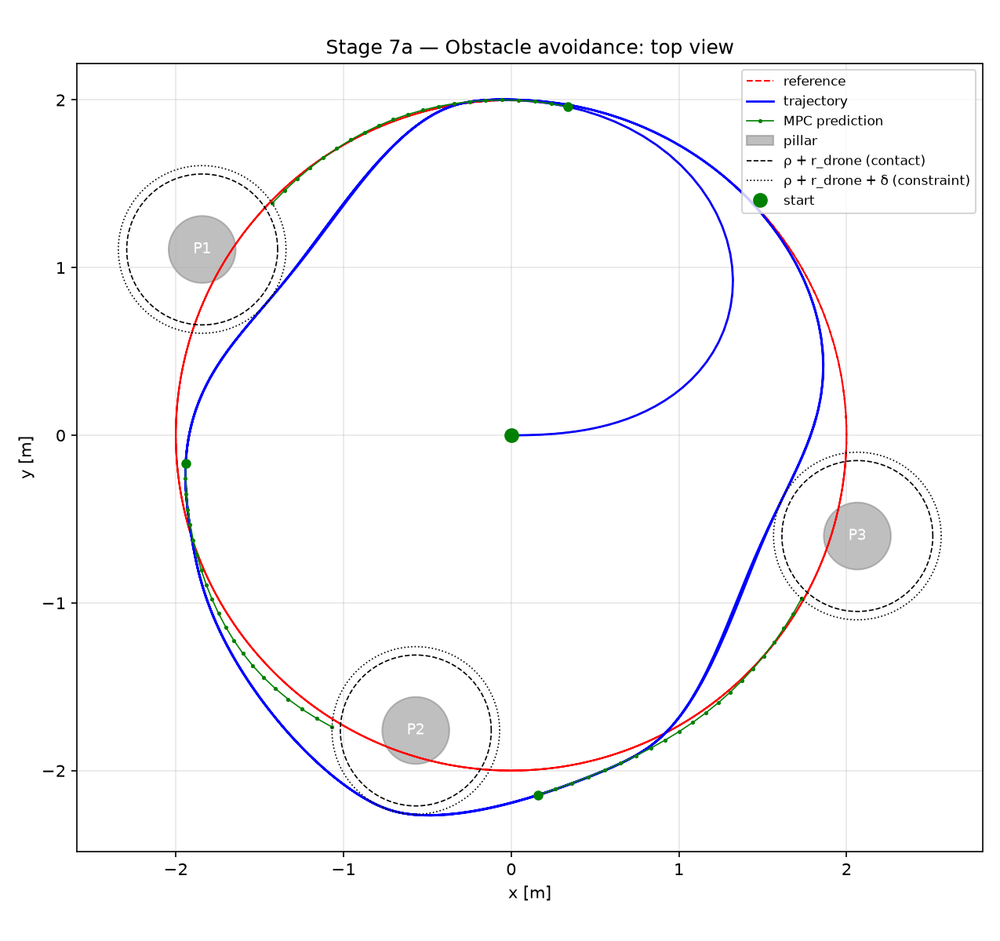
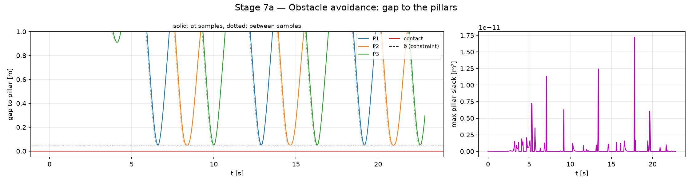
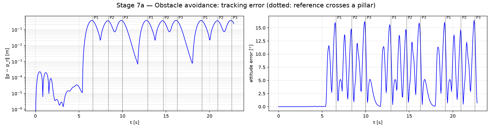
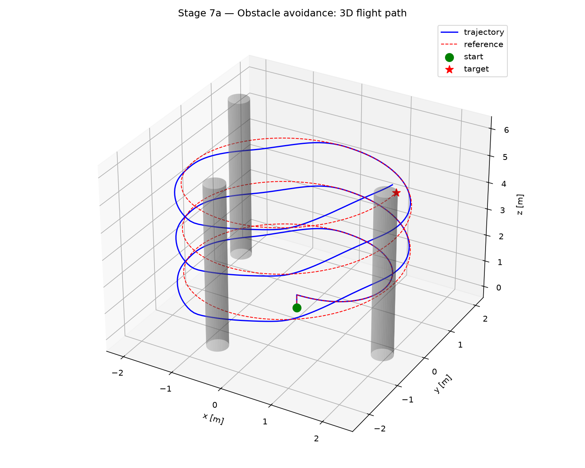
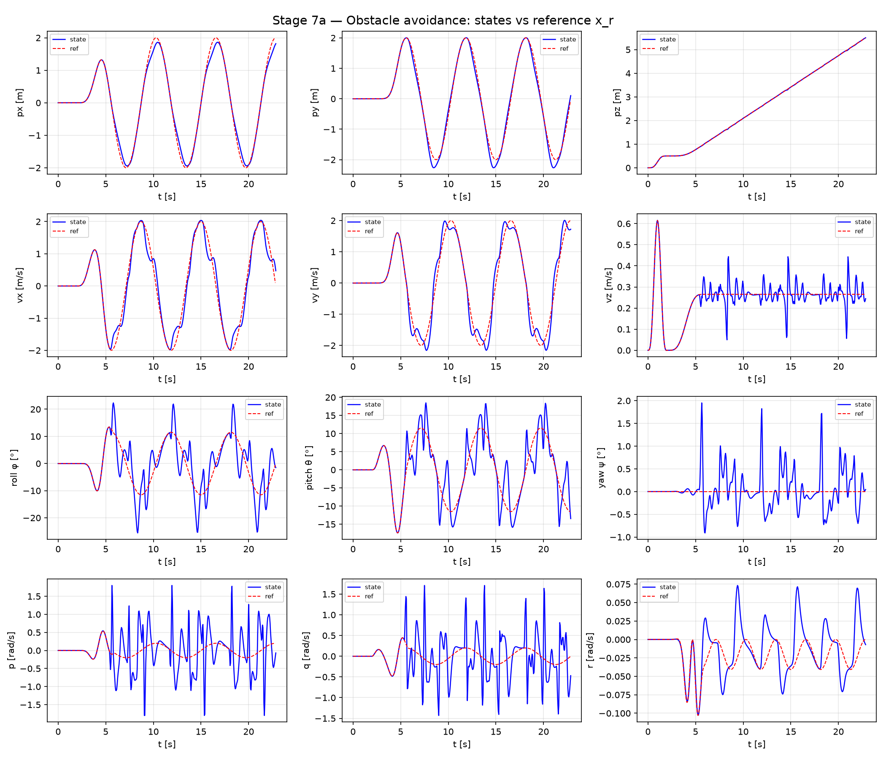
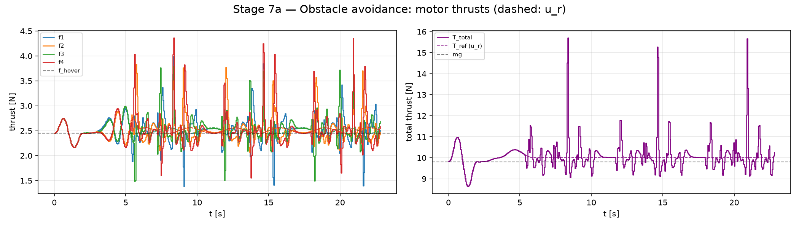

# Stage 7a — Obstacle Avoidance with State Constraints

Stage 6 tracks a helix in free space. This stage puts **obstacles on the path**: three vertical
pillars stand where the helix passes, so the reference itself runs through them. The reference is
not re-planned. The MPC keeps the Stage 6 tracking cost and gets one extra **state constraint per
obstacle**; it leaves the reference to pass each pillar and rejoins it afterwards.

The run uses the nominal plant with full state feedback. With an estimator in the loop the
constraint would hold for the estimate $\hat x$, not for the true state $x$, and a near miss could
not be told apart from estimation error. Taking the estimation error into account is a question of
constraint tightening, i.e. robust MPC.

Stage 7 has two parts on the same scene and closed loop: **7a** (this document) uses the plain
distance constraint $h_j(p_i) \ge 0$; **7b** ([stage7b_obst_dcbf.md](stage7b_obst_dcbf.md)) replaces it by a
discrete-time control barrier function.

| | |
|---|---|
| Model / plant | `create_disturbance_model()` with $\hat d = 0$ / `create_disturbance_plant()`, no disturbance |
| Feedback | full state, $\hat x = x$ |
| Horizon | $N = 20$, $T = 1$ s, $T_s = 0.05$ s (as Stage 6) |
| Solver | acados `SQP_RTI`, `PARTIAL_CONDENSING_HPIPM`, Gauss-Newton, ERK4, shifted and projected warm start |
| Reference | Stage 6 helix + flatness map, unchanged (2 m/s, 3 turns, 22.85 s) |
| Obstacles | 3 infinite vertical cylinders, radius 0.2 m |
| Entry point | `./run.sh simulate_obst_dist.py` → `results/stage7a_obst_dist/` |

---

## 1. Obstacles as state constraints

An obstacle is a set $\mathcal O_j$ the quadrotor must not enter. The quadrotor is modelled as a
ball of radius $r_{\text{drone}}$ around its centre $p$, so the obstacle is **inflated** by that
radius and $p$ is treated as a point. The OCP gets

```math
\begin{aligned}
\min_{u_0, \dots, u_{N-1}} \quad & \sum_{i=0}^{N-1} \Big( \lVert e(x_i, x_{r,i}) \rVert_Q^2 + \lVert u_i - u_{r,i} \rVert_R^2 \Big) + \lVert e(x_N, x_{r,N}) \rVert_P^2
\\ \text{s.t.} \quad & x_{i+1} = f(x_i, u_i, 0), \qquad x_0 = x(t), \qquad 0 \le u_i \le F_{\max}
\\ & h_j(p_i) \ge 0, \qquad i = 1, \dots, N, \quad j = 1, \dots, n_{\text{obs}}
\end{aligned}
```

with the cost, the dynamics and the soft rate bound of Stage 6 unchanged.

**Constraint, not cost.** The obstacle could also enter the cost as a repulsive term
("potential field"). Such a term changes the optimum even when the obstacle is far away and gives
no guarantee at any weight. A constraint has no effect until it becomes active, and when it is
active it is satisfied exactly. The tracking cost stays what it was: the reference may run straight
through a pillar, the constraint keeps the predicted path out of it, and the cost pulls the path
back to the reference once the pillar is passed.

### Pillar constraint

A pillar is an infinite vertical cylinder with axis $c_j = (c_{x,j}, c_{y,j})$ and radius
$\rho_j$. Only the horizontal position enters:

```math
h_j(p) = (p_x - c_{x,j})^2 + (p_y - c_{y,j})^2 - r_{\text{safe},j}^2,
\qquad r_{\text{safe},j} = \rho_j + r_{\text{drone}} + \delta .
```

| Symbol | Value | Meaning |
|---|---|---|
| $\rho_j$ | 0.2 m | physical pillar radius |
| $r_{\text{drone}}$ | 0.25 m | quadrotor ball: arm $L = 0.175$ m plus propeller |
| $\delta$ | 0.05 m | margin ([§3](#3-margin-between-the-nodes)) |

- **Squared distance.** The distance $\lVert p_{xy} - c_j \rVert$ is not differentiable on the
  axis. The square is smooth everywhere; its gradient vanishes only on the axis.
- **No top.** $h_j$ does not depend on $p_z$, so a pillar can only be passed on the side, never
  over it. A sphere would have more ways around it (left, right, over, under) and therefore more
  local optima.

## 2. Nonconvex free space

The free space $`\mathbb R^2 \setminus \bigcup_j \text{disk}_j`$ is not convex, so the OCP is
nonconvex even apart from the dynamics. Three consequences:

**Local optima.** Passing a pillar on the inside or on the outside of the helix are two separate
local optima. SQP converges to the one the initial guess is closer to; with RTI that is the shifted
previous solution.

**Linearization is an inner approximation.** $h_j$ is *convex* in $p$, so its linearization at the
current iterate $\bar p$ underestimates it:

```math
h_j(p) \;\ge\; h_j(\bar p) + \nabla h_j(\bar p)^\top (p - \bar p) .
```

The linearized constraint that the QP sees is a half-plane, and every point that satisfies it also
satisfies $h_j \ge 0$. A QP iterate is therefore collision-free at the nodes, not only the converged
solution. This is the separating-hyperplane view of collision avoidance in Zhang, Liniger &
Borrelli (2021).

**Where the half-plane lies depends on $\bar p$.** On the circle, $h_j(\bar p) = 0$, the half-plane
is the tangent — exact at $\bar p$ and conservative elsewhere. Inside the circle the half-plane
moves *outward*: for a circle of radius $r$ around $c$,

```math
2(\bar p - c)^\top (p - c) \;\ge\; \lVert \bar p - c \rVert^2 + r^2
\quad\Longrightarrow\quad
\text{distance from } c \;=\; \frac{\lVert \bar p - c \rVert^2 + r^2}{2 \lVert \bar p - c \rVert} \;\ge\; r ,
```

and on the axis ($\bar p = c$) the gradient vanishes and the constraint carries no information.
Both effects matter for the warm start ([§5](#5-warm-start-projected-onto-the-free-space)).

**Stability.** Recursive feasibility and stability arguments do not need convexity, and a
suboptimal solution that is at least as good as the warm-started candidate is enough (Scokaert,
Mayne & Rawlings, 1999). They do need terminal ingredients, which this stage — like Stage 6 — does
not certify. The guarantee is practical: the horizon must see a pillar early enough to swerve.

## 3. Margin between the nodes

The constraint acts only at the nodes. Between two nodes the quadrotor moves about $\ell = v T_s$ on
a nearly straight segment, and a chord of length $\ell$ whose ends lie on a circle of radius $r$
enters it by

```math
r - \sqrt{r^2 - \ell^2/4} \;\approx\; \frac{\ell^2}{8 r} .
```

At $v = 2$ m/s, $T_s = 0.05$ s and $r_{\text{safe}} = 0.5$ m this is about 2.5 mm (4 mm at the
peak speed of the swerves). The margin $\delta = 5$ cm covers it many times over; in this nominal
setting it is the safety distance the constraint keeps.

## 4. Soft constraint and exact penalty

A hard $h_j \ge 0$ can make the QP infeasible — the solver then fails instead of returning the
least bad input. The constraint is therefore soft, with a slack $s_{j,i} \ge 0$:

```math
h_j(p_i) \ge -s_{j,i}, \qquad \text{cost} \;+\!= z_1\, s_{j,i} + z_2\, s_{j,i}^2 .
```

With the **linear** term this is an exact penalty: if $z_1$ exceeds the Lagrange multiplier of the
hard constraint, the soft problem has the same solution as the hard one whenever the hard one is
feasible (Kerrigan & Maciejowski, 2000). The slack only becomes non-zero when no collision-free
solution exists.

**Choosing $z_1$.** acados multiplies the slack penalties of the path nodes by `cost_scaling`,
i.e. by $T_s$, like the stage cost. The weight $z_1 = 10^3$ of the Stage 4 $\lvert\omega\rvert$
box is therefore only 50 per node. With it, the solver traded up to 30 mm of the margin at the far
nodes of the horizon for tracking, right when a pillar entered the horizon — the multiplier was
larger than 50. With $z_1 = 10^4$ (500 per node) the slack stays at solver tolerance:

| $z_1$ | max pillar slack | min predicted gap | min closed-loop gap |
|---|---|---|---|
| $10^3$ | $3 \cdot 10^{-2}$ m² | 19.9 mm | 50.0 mm |
| $10^4$ | $2 \cdot 10^{-11}$ m² | 50.0 mm | 50.0 mm |
| $10^5$ | $1 \cdot 10^{-12}$ m² | 50.0 mm | 50.0 mm |

The closed loop kept the margin in all three cases, because only the far end of the prediction was
affected. $z_1 = 10^4$ is used.

## 5. Warm start: projected onto the free space

The Stage 6 `shift_warm_start` moves the previous solution one node forward and appends the
reference $x_r(t + N T_s)$ as the new last node. Here the reference runs **through** the pillars,
so whenever a pillar enters the horizon, the appended node lies inside it. By [§2](#2-nonconvex-free-space) the QP then sees a
half-plane that lies farther out than the circle. The one RTI iteration cannot reach it — the
soft rate bound limits how fast the quadrotor can turn — and pays with slack. In the first
implementation this produced slack up to 0.11 m² in every encounter.

`ocp_config_obstacle.shift_warm_start` calls the Stage 6 shift and then pushes every guess node
that lies inside a constraint circle **radially onto the circle**. $h_j$ is then always linearized
at a feasible point, where the half-plane is the tangent. The radial direction keeps the side of the
pillar the reference is already on, which is the shorter way round. The projection only changes
the initial guess (positions only); the OCP is the same.

| Warm start | max pillar slack ($z_1 = 10^3$) |
|---|---|
| Stage 6 shift | 0.11 m² |
| shift + projection | 0.03 m² |

The remaining slack in this table is the penalty-weight effect of [§4](#4-soft-constraint-and-exact-penalty).

## 6. Mapping to acados

| Theory | acados |
|---|---|
| $h_j(p_i) \ge 0$, $i = 1 \dots N-1$ | `con_h_expr` = $h(p)$ (one row per pillar), `lh = 0`, `uh = ACADOS_INFTY` |
| $h_j(p_N) \ge 0$ | `con_h_expr_e`, same bounds |
| no constraint at node 0 | `con_h_expr_0` left empty: $x_0$ is fixed, a violated $h$ there could only make the QP infeasible |
| slack $s_{j,i}$ | `idxsh` / `idxsh_e`; `zl`, `Zl` appended after the three $\lvert\omega\rvert$ slacks (acados orders slacks `bu, bx, g, h`) |
| one-sided bound | `uh = ACADOS_INFTY` ($10^{10}$): HPIPM masks it out |
| pillar positions | compiled into the solver as constants — the parameter stays $`p_i = [\,\hat d;\; x_{r,i};\; u_{r,i}\,]`$ |

To reuse the Stage 6 problem without copying it, `ocp_config_trajectory.create_solver` was split
into `create_ocp` (the uncompiled `AcadosOcp`) and `create_solver` (compile). Stage 6 itself is
unchanged: its nominal run reproduces the same numbers and byte-identical figures.

## 7. Scenario

```
(X_r, U_r)_k = flatness( helix(t_k + i·Ts) ),  i = 0..N          Stage 6, unchanged
u_k          = MPC(x_k, X_r, U_r)            soft h_j(p_i) ≥ 0, i = 1..N, projected warm start
x_{k+1}      = plant(x_k, u_k)               nominal, full state feedback
```

The pillars stand at three phase angles $\theta$ of the helix, each **off-centre** by 0.15 m:

| Pillar | $\theta$ | centre radius | centre | passed on the |
|---|---|---|---|---|
| P1 | 2.6 rad | 2.15 m | $(-1.84,\, 1.11)$ m | inside |
| P2 | 4.4 rad | 1.85 m | $(-0.57,\, -1.76)$ m | outside |
| P3 | 6.0 rad | 2.15 m | $(2.06,\, -0.60)$ m | inside |

- **Why off-centre.** A pillar exactly on the helix circle would put the reference — the initial
  guess — through its axis, where $\nabla h_j = 0$, and would make both sides equally good. With
  the offset, the shorter way round is well defined: $0.15 + 0.5 = 0.35$ m to the near side,
  $0.65$ m to the far side.
- **Three turns.** The pillars have no top and the helix makes three turns, so each pillar is
  crossed three times at different heights: 9 encounters, at $t = 6.6, 8.4, 10.0$ s, then every
  $2\pi$ s. The phase angles lie in $[2, 2\pi)$ rad, the part of the circle the cruise phase crosses
  three times; the spiral-out ends at $\theta = 2$ rad and passes no pillar.
- **Spacing.** P1 → P2 → P3 are 1.8 and 1.6 s apart, P3 → P1 2.9 s; the horizon is 1 s
  (≈ 2 m).

## 8. Results

All figures are in `results/stage7a_obst_dist/`; the numbers are printed by `summarize()`.

| Metric | Value |
|---|---|
| min gap to a pillar, at the samples | 50.0 mm ($= \delta$) |
| min gap between the samples (straight segments) | 47.6 mm |
| max pillar slack | $2 \cdot 10^{-11}$ m² |
| $\lVert p - p_r \rVert$ RMS / max | 188 / 378 mm (deliberate) |
| max tilt | 25.9° (reference 17.5°) |
| max $\lvert\omega\rvert$ | 1.80 rad/s (soft bound 1.80) |
| motor thrusts | $`[1.38,\, 4.37]`$ N, never saturated |
| MPC time mean / p99 / max | 5.2 / 10.8 / 16.3 ms (budget 50 ms) |

### 8.1 Top view

<p align="center">
  
</p>

The three turns lie on top of each other in this view. P1 and P3 are passed on the inside of the
helix (radius 1.66 m at the crossing), P2 on the outside (2.34 m) — the near sides of [§7](#7-scenario), 0.35 m
from the reference. The green curves are the MPC predictions at the first solve that sees each
pillar: the end of the horizon already bends around the dotted constraint circle while the
quadrotor is still on the reference.

Because the pillars are only 1.6–1.8 s apart, the quadrotor does not fully return to the reference
between P1, P2 and P3; it flies a smooth curve from one pillar to the next. It rejoins the
reference only in the longer gap from P3 to P1 and around the top of the circle.

### 8.2 Gap to the pillars



The gap $\lVert p_{xy} - c_j \rVert - \rho_j - r_{\text{drone}}$ falls to exactly $\delta = 50$ mm at
each of the 9 crossings and never below: the constraint is active at the closest point and the
quadrotor rides along the constraint circle. The dotted curves (the closest point on the straight
segment between two samples) dip to 47.6 mm — the chord effect of [§3](#3-margin-between-the-nodes), 2.4 mm, within the 4 mm
bound at the peak speed. The slack (right) stays at
$\sim 10^{-11}$ m², i.e. the soft constraint behaved as a hard one.

### 8.3 Tracking error



- Until $t \approx 5.5$ s (take-off and spiral-out) the error is that of Stage 6 nominal,
  below 0.2 mm. Then P1 enters the horizon.
- The quadrotor leaves the reference about 1 s (one horizon) before each crossing. The error peaks
  at 0.35–0.38 m around the crossings (dotted lines): the 0.35 m radial offset plus a small lag
  along the path.
- Between P3 and P1 the error falls back to below 1 mm; between P1, P2 and P3 it does not drop below
  2 cm ([§8.1](#81-top-view)).
- The attitude error reaches 16°: swerving 0.35 m within about 1 s at 2 m/s takes lateral
  acceleration on top of the centripetal 2 m/s².

### 8.4 Flight path

<p align="center">
  
</p>

The flown path (blue) follows the reference helix (red, dashed) and bends around the pillars on
each of the three turns. The figure's perspective makes the path appear to cross the pillars;
the top view shows the true horizontal clearance.

### 8.5 States and motor thrusts





- Roll reaches 25.6° and pitch 18.5° during the swerves, against 17.5° on the reference.
- The body rates touch the soft bound 1.8 rad/s in 8 samples (1.7 %), at the moment a pillar
  enters the horizon and the swerve starts. The rate bound — kept from Stage 6 — is what limits
  how late the quadrotor can react.
- The motor thrusts stay in $`[1.38,\, 4.37]`$ N, far from both limits $`[0,\, 7.36]`$ N.

### 8.6 Computation time

The mean MPC time rises from 4.0 ms (Stage 6 nominal) to 5.2 ms. In 46 % of the solves at least
one predicted node is on a constraint circle (an active constraint); those solves take 5.5 ms on
average, the others 4.9 ms. The maximum, 16 ms, stays far below the 50 ms sample time. As in
Stage 6, the times are wall-clock times on WSL and vary between runs.

## 9. Observations and limitations

- **Practical, not certified, safety.** Collision-free predictions at every solve plus a positive
  margin between the nodes give a collision-free flight in this run. There is no terminal set that
  is safe and invariant, so there is no recursive-feasibility guarantee: a pillar that appears too
  late (shorter horizon, higher speed, tighter rate bound) would force the slack to be used.
- **Reaction starts at the horizon.** The constraint becomes active only when the pillar enters
  the 1 s horizon, and then the swerve is as fast as the rate bound allows. A discrete-time control
  barrier function, $h(x_{i+1}) \ge (1 - \gamma)\, h(x_i)$, limits how fast $h$ may decrease and
  makes the quadrotor start avoiding earlier (Zeng, Zhang & Sreenath, 2021) — implemented in
  Stage 7b ([stage7b_obst_dcbf.md](stage7b_obst_dcbf.md)).
- **Side chosen by the warm start.** The radial projection picks the side the reference is on.
  For a pillar centred exactly on the path the choice would be arbitrary ([§7](#7-scenario)).
- **Nominal, full state.** No noise, no estimator, no disturbance. With the MHE the margin $\delta$
  must also cover the position-estimation error.
- **Static, known obstacles.** The pillars are compiled into the solver. Moving obstacles would
  need their positions as runtime parameters.
- **Reference not re-planned.** The flatness reference still runs through the pillars; the MPC
  alone resolves the conflict.

## 10. Experiments: taking the design apart

The main run works partly because of design choices that [§4](#4-soft-constraint-and-exact-penalty)–[§7](#7-scenario) justify: projected warm start,
slack weight, pillar offsets, horizon, soft constraint. Five experiments switch one of them off at
a time. Each one is a change of one or two lines; the numbers come from runs of the unchanged
scene with only that change. "At the rate bound" counts the samples with
$`\max_i \lvert\omega_i\rvert > 0.97 \cdot 1.8`$ rad/s.

### 10.1 Warm start without projection

`obstacle_sim_config.py`: `traj.shift_warm_start(solver, ref.x_r, ref.u_r, N)` instead of
`obs.shift_warm_start(..., PILLARS)` — the Stage 6 function takes no pillars.

| Warm start | max slack | min gap (samples / between) | at the rate bound |
|---|---|---|---|
| projected (main run) | $2 \cdot 10^{-11}$ m² | 50.0 / 47.6 mm | 1.7 % |
| Stage 6 shift | $2 \cdot 10^{-11}$ m² | 50.0 / 47.6 mm | **13.1 %** |

With $z_1 = 10^4$ the drone still passes cleanly — the slack of 0.11 m² in [§5](#5-warm-start-projected-onto-the-free-space) was measured with
$z_1 = 10^3$. What the projection buys here is **smoothness**. Linearized inside the circle, the
constraint asks for a half-plane far beyond it ([§2](#2-nonconvex-free-space)). The one RTI step jumps toward it, and the
body rates hit the bound eight times as often. The flown path is visibly jerky.

### 10.2 Slack weight below the multiplier

`ocp_config_obstacle.py`: `Z_L1 = 1e3`.

| $z_1$ | max slack | min predicted gap | min closed-loop gap |
|---|---|---|---|
| $10^4$ (main run) | $2 \cdot 10^{-11}$ m² | 50.0 mm | 50.0 mm |
| $10^3$ | $3 \cdot 10^{-2}$ m² | 19.9 mm | 50.0 mm |

The soft constraint is no longer exact: the far end of each prediction cuts up to 30 mm into the
margin. The closed loop still keeps 50 mm: the violation stays in the far part of the prediction
and is corrected in later solves, before those nodes are reached.

In the top view the green predictions now lie on the flown path instead of on the reference. That is
a property of the plot, not of the controller: it shows the prediction that comes *closest* to
each pillar (`first_sightings`). With $z_1 = 10^3$ that is the one dipping into the margin, which
happens later in the swerve, when the quadrotor has already left the reference.

### 10.3 Pillars centred on the path

`obstacle_sim_config.py`: radial offset `0.0` for all three pillars in `PILLAR_SITES`.

| Crossing | P1 | P2 | P3 |
|---|---|---|---|
| turn 1 | inside | inside | **outside** |
| turn 2 | inside | inside | inside |
| turn 3 | inside | inside | inside |

0 failed solves, minimum gap 50.0 mm at every crossing, 23.8 % of the samples at the rate bound,
$\lVert p - p_r \rVert$ up to 0.52 m (the sidestep is now 0.5 m instead of 0.35 m). The predictions
needed slack up to 0.78 m².

- **No braking, no deadlock.** The quadrotor always picks a side. The expected stall — the warm
  start running through the axis, where $\nabla h_j = 0$ — does not occur, because no node lands
  exactly on the axis.
- **Inside preferred.** A reference node near the pillar lies on the helix circle. Seen from the
  pillar centre it lies mostly *along* the path and slightly inward, because the circle bends toward
  the axis. The radial projection therefore pushes the guess back along the path and a little
  inward. Passing on the inside of the bend is also the shorter way.
- **The choice is arbitrary.** At the first P3 crossing the quadrotor goes outside. A few
  millimetres of difference in the state when the pillar enters the horizon decide the side. This
  is the local-optimum issue of [§2](#2-nonconvex-free-space) in its purest form, and the reason for the offsets in [§7](#7-scenario).

### 10.4 Shorter horizon

`obstacle_sim_config.py`: `T_HORIZON` and `N`. Note `TS = T_HORIZON / N`: changing only `N` keeps the
horizon and changes the **sample time**, for the plant too.

| $N$ | $T$ | $T_s$ | max slack | min gap (predicted / samples / between) | at the rate bound |
|---|---|---|---|---|---|
| 20 | 1.0 s | 0.05 s | $2 \cdot 10^{-11}$ m² | 50.0 / 50.0 / 47.6 mm | 1.7 % |
| 10 | 1.0 s | **0.10 s** | $9 \cdot 10^{-12}$ m² | 50.0 / 50.0 / **39.8** mm | 2.6 % |
| 10 | 0.5 s | 0.05 s | $5 \cdot 10^{-3}$ m² | 45.5 / 45.6 / 44.3 mm | 32 % |
| 6 | 0.3 s | 0.05 s | 0.30 m² | 33.8 / 43.1 / 42.4 mm | 41 % |

- **$N = 10$, $T = 1$ s** flies like the main run. Only the gap between samples shrinks: the chord
  $\ell = v T_s$ doubles, and the bound $\ell^2/(8r)$ of [§3](#3-margin-between-the-nodes) grows four times.
- **Shorter horizons** still give no collision: a 0.35 m sidestep fits into 0.3 s. The cost shows
  up first as effort (rate bound in a third to half of the samples), then as margin (down to
  43 mm). The trajectory in the top view hardly changes; the rate plots do.

### 10.5 Hard constraint

`ocp_config_obstacle.py`, `add_pillar_constraints`: remove `idxsh` / `idxsh_e` **and** the two
`_append` loops. Otherwise the slack weight vectors no longer match the number of slacks, and acados
reports a dimension error.

| Horizon | Constraint | Solver status | min gap | at the rate bound |
|---|---|---|---|---|
| 1.0 s ($N = 20$) | hard | 457 × ok | 50.0 mm | 1.7 % |
| 0.3 s ($N = 6$) | hard | 457 × ok | 50.0 mm | 54 % |
| 0.3 s ($N = 6$) | soft | 457 × ok | 43.1 mm | 41 % |
| 0.2 s ($N = 4$) | hard | **197 × QP failure** (status 4) | 59.9 mm | 56 % |
| 0.2 s ($N = 4$) | soft | 457 × ok | **−110 mm (collision)** | 50 % |

- **1 s:** hard and soft give the same flight — the exact penalty of [§4](#4-soft-constraint-and-exact-penalty) in action. Removing the
  slack changes nothing while the hard problem is feasible.
- **0.3 s:** the hard problem is still feasible and holds 50 mm exactly. The soft one *chooses* to
  give up 7 mm to save rate effort: at this horizon the multiplier exceeds $z_1 T_s = 500$, and the
  penalty is no longer exact.
- **0.2 s:** keeping the margin is impossible. The hard version fails 197 of 457 QPs. It stays
  clear only by luck — a failed solve still applies its last iterate. The soft version never fails
  but flies **11 cm into the pillar**. Once the problem is infeasible, the slack weight alone decides
  how much violation is worth it, and a solver that never fails says nothing about safety.

### 10.6 What the experiments show

- **Where SQP linearizes matters.** A feasible linearization point (projected warm start) gives
  a smooth flight; an infeasible one a jerky flight (10.1).
- **A soft constraint is exact only while the hard problem is feasible *and* $z_1$ exceeds the
  multiplier** (10.2, 10.5). The multiplier grows as the horizon shrinks.
- **A shorter horizon costs effort first, then margin, then safety** — and the soft constraint
  hides all three until the collision (10.4, 10.5). Guaranteeing the constraint under such
  conditions is a robust-MPC question.
- **The side of a symmetric obstacle is arbitrary** (10.3); a non-symmetric scene, or a planner
  that fixes the homotopy class, is needed to make it deterministic.

## Files

| File | Role |
|---|---|
| `ocp_config_obstacle.py` | `Pillar`, `h_pillars()`, `add_pillar_constraints()`, `create_solver()`, projected `shift_warm_start()`, `clearance()`, `clearance_between_samples()`, `obstacle_slack()` |
| `obstacle_sim_config.py` | scene (`PILLAR_SITES`), closed loop `simulate(gamma=None)`, `summarize()`, `make_figures()` — shared with Stage 7b |
| `simulate_obst_dist.py` | entry point: `simulate()` with the distance constraint → `results/stage7a_obst_dist/` |
| `ocp_config_trajectory.py` | Stage 6 OCP, now split into `create_ocp()` + `create_solver()` (unchanged result) |
| `plot_utils.py` | `plot_obstacle_topview()`, `plot_obstacle_clearance()` (new); `plot_3d_trajectory(..., cylinders=)` |

```bash
./run.sh simulate_obst_dist.py                   # → results/stage7a_obst_dist/
QUAD_PLOTS=none ./run.sh simulate_obst_dist.py   # save only, no windows
```

## References

- B. Lindqvist, S. S. Mansouri, A. Agha-mohammadi, G. Nikolakopoulos, "Nonlinear MPC for collision
  avoidance and control of UAVs with dynamic obstacles," *IEEE Robotics and Automation Letters*
  5(4), 2020.
- X. Zhang, A. Liniger, F. Borrelli, "Optimization-based collision avoidance," *IEEE Transactions
  on Control Systems Technology* 29(3), 2021.
- E. C. Kerrigan, J. M. Maciejowski, "Soft constraints and exact penalty functions in model
  predictive control," *UKACC International Conference on Control*, 2000.
- P. O. M. Scokaert, D. Q. Mayne, J. B. Rawlings, "Suboptimal model predictive control (feasibility
  implies stability)," *IEEE Transactions on Automatic Control* 44(3), 1999.
- J. Zeng, B. Zhang, K. Sreenath, "Safety-critical model predictive control with discrete-time
  control barrier function," *American Control Conference (ACC)*, 2021.
