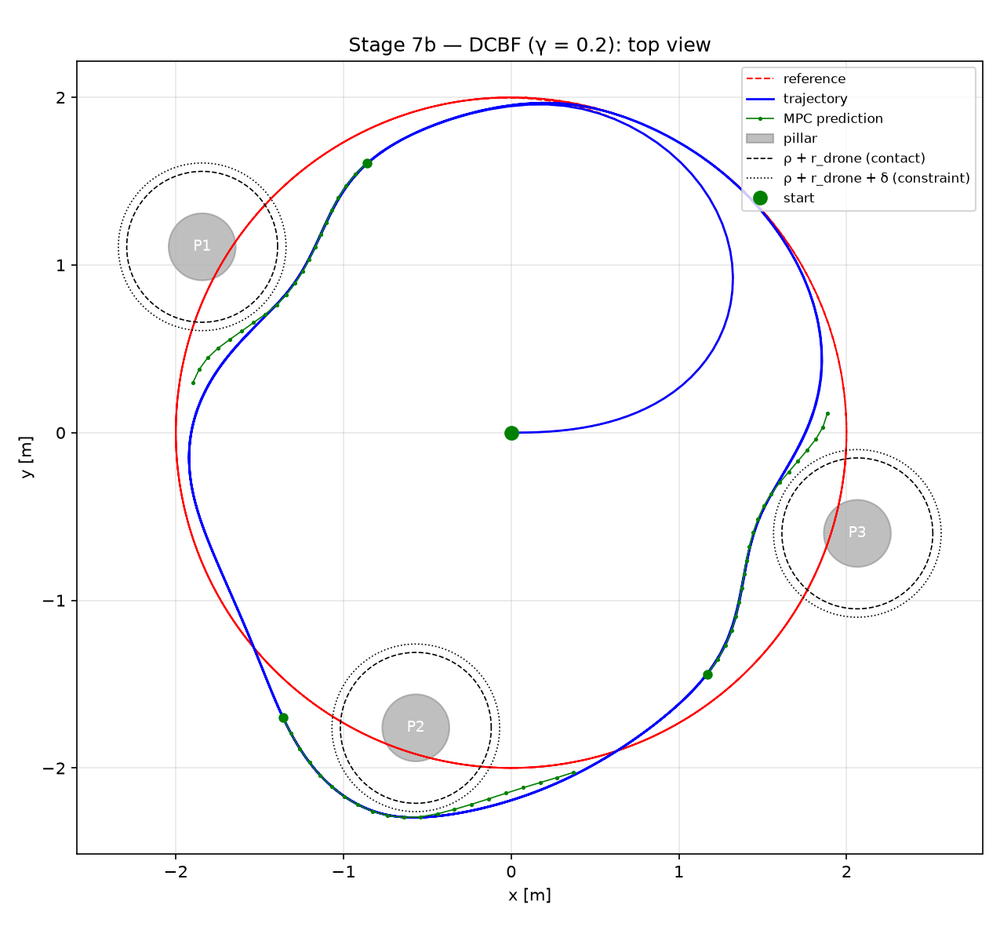
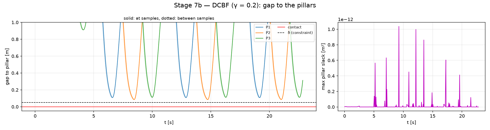
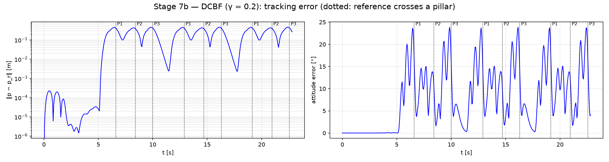
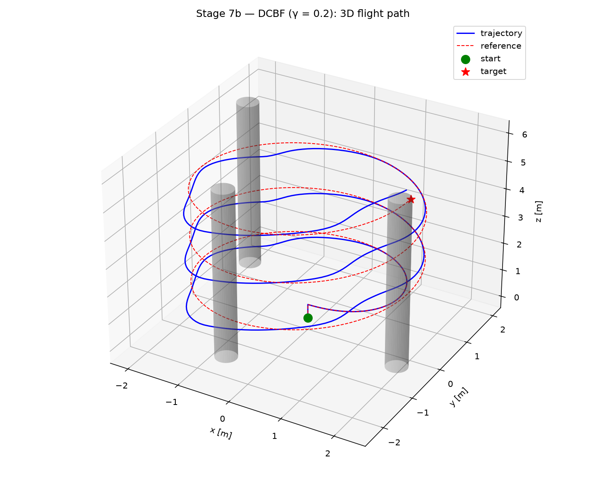
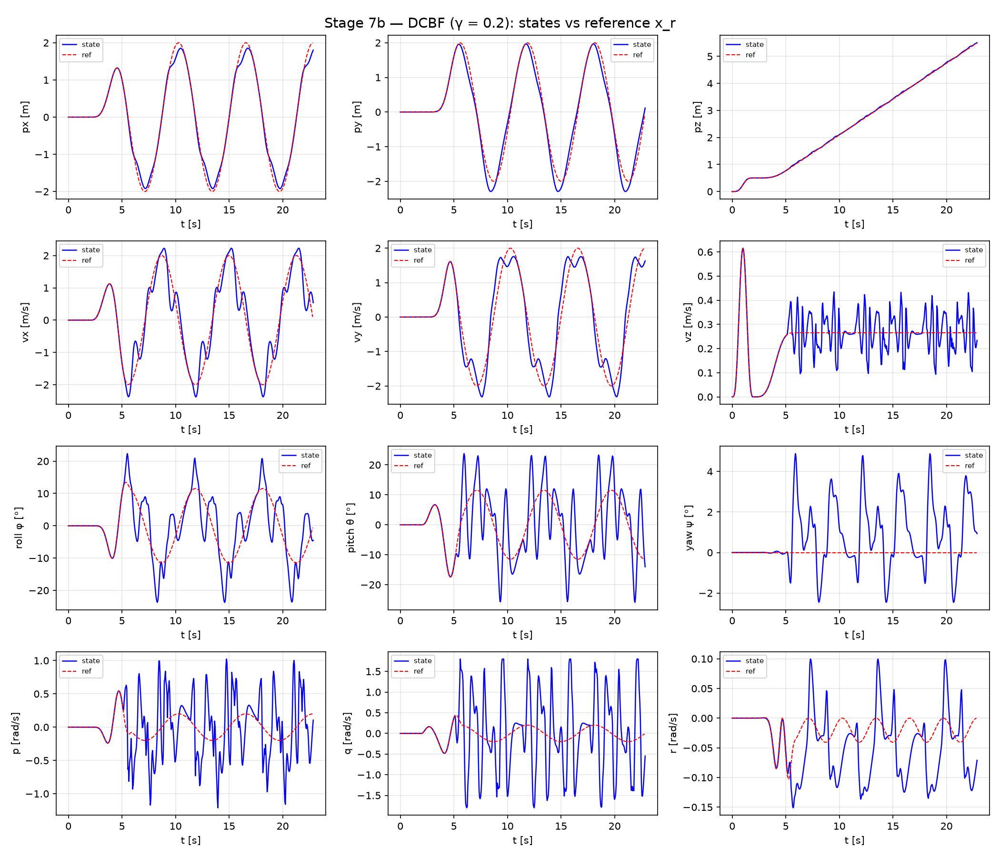
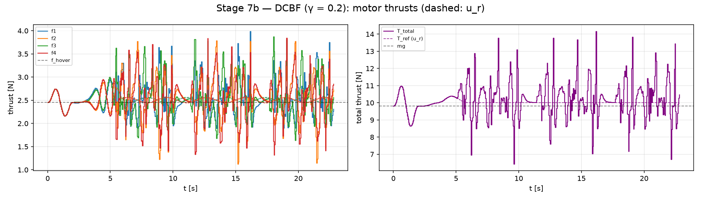
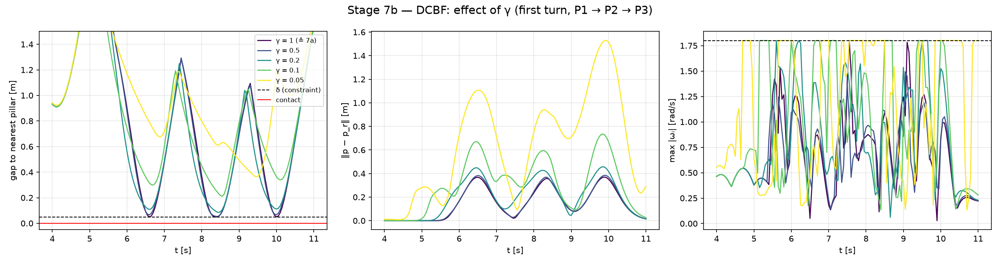

# Stage 7b — Obstacle Avoidance with a Discrete-Time Control Barrier Function

Stage 7a keeps the quadrotor out of the pillars with the distance constraint $h_j(p_i) \ge 0$. That
constraint does nothing until a predicted node reaches the constraint circle. Then the quadrotor
swerves as hard as the rate bound allows. This stage keeps the scene, the closed loop and the cost of
7a. It replaces only the obstacle constraint by a **discrete-time control barrier function
(DCBF)**, which limits how fast the quadrotor may approach an obstacle, not only how close it may
get.

| | |
|---|---|
| Scene, plant, feedback | as Stage 7a: Stage 6 helix through three pillars, nominal plant, full state feedback |
| Horizon / solver | $N = 20$, $T = 1$ s, $T_s = 0.05$ s; acados `SQP_RTI`, projected shifted warm start |
| Obstacle constraint | $`h_j(x_{i+1}) \ge (1-\gamma)\, h_j(x_i)`$, $i = 0, \dots, N-1$, soft |
| Main run | $\gamma = 0.2$ |
| Entry point | `./run.sh simulate_obst_dcbf.py [--sweep]` → `results/stage7b_obst_dcbf/` |

---

## 1. From a distance constraint to a barrier function

$h_j$ is the same function as in 7a: the squared horizontal distance to the axis of pillar $j$ minus
$r_{\text{safe},j}^2$, with $r_{\text{safe}} = \rho + r_{\text{drone}} + \delta$. The safe set is
$`\mathcal C_j = \{x : h_j(x) \ge 0\}`$.

The DCBF condition of Zeng, Zhang & Sreenath (2021) is

```math
h_j(x_{i+1}) \;\ge\; (1-\gamma)\, h_j(x_i), \qquad 0 < \gamma \le 1 .
```

- **Forward invariance.** By induction, $`h_j(x_i) \ge (1-\gamma)^i h_j(x_0) \ge 0`$. Any input
  that satisfies the condition keeps a state inside $\mathcal C_j$ inside it. The condition is
  imposed from $i = 0$ on, so it filters the **applied** input $u_0$.
- **Decay rate.** $h_j$ may shrink by at most the fraction $\gamma$ per sample. $\gamma = 1$ allows
  any decrease down to $h_j = 0$: this is exactly the 7a constraint. A smaller $\gamma$ requires a
  slower approach.
- **When it becomes active.** Far from the pillar, $h_j \approx d^2$ with $d$ the distance to the
  axis. Approaching at speed $v$, $h_j$ falls by about $2 v T_s / d$ per sample, so the condition
  binds once

```math
d \;\lesssim\; \frac{2\, v\, T_s}{\gamma}
\qquad (v = 2 \text{ m/s}: \;\; \gamma = 0.5 \to 0.4 \text{ m}, \;\; \gamma = 0.2 \to 1 \text{ m}, \;\; \gamma = 0.1 \to 2 \text{ m}, \;\; \gamma = 0.05 \to 4 \text{ m}) .
```

  This distance does not depend on the horizon. For $\gamma = 0.5$ it lies inside
  $r_{\text{safe}} = 0.5$ m, so the estimate breaks down there; near the circle $h_j = d^2 - r^2$
  falls faster, and the condition binds only in the final approach.

## 2. Implementation (`ocp_config_obstacle.py`, `gamma=`)

**Two nodes in one constraint.** An acados constraint sees one node $(x_i, u_i)$, but the DCBF
couples $x_i$ and $x_{i+1}$. The next state is therefore written *inside* the constraint as one RK4
step $F$ of length $T_s$:

```math
c_j(x_i, u_i) \;=\; h_j\big(F(x_i, u_i)\big) - (1-\gamma)\, h_j(x_i) \;\ge\; 0,
\qquad i = 0, \dots, N-1 .
```

$F$ (`rk4_step`) is built from `model.f_expl_expr` and is the same discretization the OCP uses
(ERK, 4 stages, one step per interval). On a converged, defect-free trajectory
$`h_j(F(x_i, u_i)) = h_j(x_{i+1})`$ exactly.

| Theory | acados |
|---|---|
| row on $u_0$ (the safety filter) | `con_h_expr_0` = $c(x, u)$, `lh_0 = 0`, `uh_0 = ACADOS_INFTY`, `idxsh_0` |
| rows $i = 1 \dots N-1$ | `con_h_expr` = $c(x, u)$ |
| no terminal row | $`h_j(x_N) \ge (1-\gamma) h_j(x_{N-1})`$ is the $i = N-1$ row |
| slacks | stage 0 has no $\lvert\omega\rvert$ slack, so `zl_0` holds only the pillar weights; stages $1 \dots N-1$ append them after the $\lvert\omega\rvert$ slacks |
| one solver per $\gamma$ | model name `quadrotor_3d_obst_dcbf_g0p2` etc., so several $\gamma$ can run in one process |

`create_solver(pillars, ..., gamma=None)` builds 7a, and `gamma=γ` builds 7b. The closed loop
`obstacle_sim_config.simulate(gamma=)` is shared, including the warm start that projects guess nodes
onto the constraint circles.

**Check against 7a.** With $\gamma = 1$ the DCBF form must reproduce the distance constraint. It
does: minimum gap 50.0 mm, slack $10^{-12}$, the same tracking error (sweep table, [§5](#5-effect-of-gamma---sweep)). It is
written differently — $h_j$ of an RK4 step on nodes $0 \dots N-1$ instead of $h_j$ of the state on
nodes $1 \dots N$ — so this also checks the RK4-in-constraint construction.

## 3. What changes compared with 7a

- **No inner approximation.** In 7a, $h_j$ is convex in $p$, so its linearization is a half-plane
  inside the free space and every QP iterate is collision-free at the nodes. $c_j$ is a difference
  of two convex functions composed with the dynamics, so this property is lost: only a converged
  solution satisfies it. In the closed loop the condition
  $`h_j(x_{k+1}) \ge (1-\gamma) h_j(x_k)`$ was nevertheless never violated by more than
  $10^{-3}$ m², for any $\gamma$ of the sweep.
- **Feasibility.** A small $\gamma$ requires an early, slow approach. If the state is already
  approaching too fast, no input can meet the decay rate in time. The soft slack — the relaxation
  that Zeng et al. propose for this — keeps the QP solvable.
- **Larger multipliers.** With the 7a weight $z_1 = 10^4$ the rows at the far end of the horizon
  took slack, up to 0.3 m² at $\gamma = 0.05$. The DCBF binds over many nodes against the pull of
  the tracking cost, so its multipliers exceed $z_1 T_s = 500$. With $z_1 = 10^5$ (`Z_L1_DCBF`) the
  slack is at solver tolerance ($10^{-12}$) for $\gamma \ge 0.1$, and $7 \cdot 10^{-4}$ m² at
  $\gamma = 0.05$. The closed-loop condition held with both weights.

## 4. Main run, $\gamma = 0.2$

All figures are in `results/stage7b_obst_dcbf/`.

| Metric | 7b, $\gamma = 0.2$ | 7a |
|---|---|---|
| failed OCP calls | 0 / 457 | 0 / 457 |
| min gap at samples / between samples | 84.9 / 83.9 mm | 50.0 / 47.6 mm |
| min gap per pillar P1 / P2 / P3 | 108 / 85 / 111 mm | 50 / 50 / 50 mm |
| max pillar slack | $1 \cdot 10^{-12}$ m² | $2 \cdot 10^{-11}$ m² |
| avoidance starts before the first crossing ($\lVert p - p_r \rVert > 1$ cm) | 1.25 s | 1.00 s |
| node-0 row active (closed loop) | 19.7 % of samples | 2.4 % |
| $\lVert p - p_r \rVert$ RMS / max | 243 / 462 mm | 188 / 378 mm |
| max $\lvert\omega\rvert$ / samples at the bound | 1.80 rad/s / 4.4 % | 1.80 rad/s / 1.5 % |
| largest one-sample change of a body rate | 0.97 rad/s | 1.62 rad/s |
| max tilt | 26.0° | 26.1° |
| motor thrusts | $`[1.12,\, 3.99]`$ N | $`[1.38,\, 4.37]`$ N |
| MPC time mean / p99 / max | 4.1 / 6.4 / 11.2 ms | 3.7 / 6.5 / 10.2 ms |

(7a numbers from the run made at the same time; wall-clock times vary between runs.)

### 4.1 Top view

<p align="center">
  
</p>

The quadrotor passes on the same sides as in 7a, but the path no longer runs along the dotted
constraint circles: it stays 35–60 mm farther out and bends away earlier. The green curves are the
predictions of the solve that comes closest to each pillar.

### 4.2 Gap to the pillars



The gap never reaches $\delta$. It approaches its minimum smoothly, without the flat contact
phase of 7a, because $h_j$ may only decay geometrically. P2, the pillar passed on the outside of the
helix, comes closest (85 mm). P1 and P3 keep about 110 mm. The slack stays at $10^{-12}$.

### 4.3 Tracking error



The deviation starts about 0.25 s earlier than in 7a and is 20–30 % larger. The node-0 row first
binds 0.6 s before the first crossing. The deviation starts earlier still, because the rows at the
later nodes of the prediction already shape the plan. The attitude error peaks at about 24°
(7a: 16°): the wider swerve needs more lateral acceleration.

### 4.4 Flight path, states and motor thrusts

<p align="center">
  
</p>





The states look like those of 7a with wider swerves. The thrusts stay far from both limits.

## 5. Effect of $\gamma$ (`--sweep`)

`python simulate_obst_dcbf.py --sweep` runs $\gamma \in \{1, 0.5, 0.2, 0.1, 0.05\}$ on the same scene:

| $\gamma$ | min gap [mm] | max slack [m²] | avoidance starts before P1 [s] | node-0 row active | $\lVert p - p_r \rVert$ RMS / max [mm] | samples at the rate bound | largest one-sample change of a body rate [rad/s] | max tilt |
|---|---|---|---|---|---|---|---|---|
| 1 (≙ 7a) | 50.0 | $1 \cdot 10^{-12}$ | 1.00 | 2.4 % | 187 / 373 | 1.5 % | 1.62 | 26.1° |
| 0.5 | 53.2 | $7 \cdot 10^{-13}$ | 1.00 | 3.5 % | 192 / 385 | 0 % | 1.06 | 26.5° |
| 0.2 | 84.9 | $1 \cdot 10^{-12}$ | 1.25 | 19.7 % | 243 / 462 | 4.4 % | 0.97 | 26.0° |
| 0.1 | 210.9 | $9 \cdot 10^{-13}$ | 1.60 | 40.7 % | 360 / 735 | 16.6 % | 2.04 | 32.5° |
| 0.05 | 359.1 | $7 \cdot 10^{-4}$ | 3.60 | 63.2 % | 742 / 1531 | 36.0 % | 3.60 | 40.2° |

All runs: 0 failed solves, MPC 4–5 ms per call on average. The columns "node-0 row active" and
"largest one-sample change" are computed from the closed-loop states (for $\gamma = 1$ from the 7a
run, the same constraint); `print_sweep` prints the others.



- **Earlier and farther — as designed.** The smaller $\gamma$, the earlier the avoidance starts and
  the larger the gap. At $\gamma = 0.05$ the quadrotor starts 3.6 s before the first crossing and
  stays at least 36 cm away.
- **Not gentler in this scene.** One might expect an earlier start to make the swerve softer. That
  holds only down to $\gamma \approx 0.2$. Below that, the rate bound is reached more and more often
  (36 % of the samples at $\gamma = 0.05$), the tilt grows to 40°, and the body rates chatter
  (right panel). The reason is the activation distance of [§1](#1-from-a-distance-constraint-to-a-barrier-function): at $\gamma = 0.05$ it is 4 m, the
  diameter of the helix. The condition binds for *all three* pillars almost all the time (63 % of
  the samples at node 0). The quadrotor is pushed away from every pillar at once while the tracking
  cost pulls it along the circle. In a cluttered scene a small $\gamma$ is **conservative**, not
  smooth.
- **$\gamma = 0.5$** gives the softest flight: nearly the path of 7a (min gap 53 instead of 50 mm,
  tracking error within 3 %), but the body rates never reach the bound and the largest one-sample change of a body rate falls from 1.62 to
  1.06 rad/s. The condition binds only in the last part of the approach and rounds off the hard
  contact with the constraint circle.
- **$\gamma = 0.2$** (main run) is the smallest value with a clearly earlier avoidance and a larger
  gap that still flies smoothly.

## 6. Observations and limitations

- **Relative degree.** $h_j$ depends on position only. $u_0$ changes $p_1$ only through the thrust
  magnitude, scaled by about $T_s^2/2$; the attitude, which turns the thrust, is a state and needs
  further samples to change. The node-0 row is therefore almost a condition on the current state. It
  stays satisfiable only because the rows at the later nodes plan the approach ahead. A barrier
  with the velocity in it — a high-order CBF (Xiao & Belta, 2022) — acts on the input directly. It
  is not implemented here.
- **No certificate beyond the horizon.** Forward invariance holds for inputs that satisfy the
  condition. Whether the OCP stays feasible is not certified (no terminal set), as in 7a. The slack
  hides an infeasible step instead of failing.
- **One $\gamma$ for all pillars and all distances.** The activation distance scales with $1/\gamma$
  and with the approach speed. In a denser scene, or at higher speed, $\gamma$ has to grow to keep
  the condition from binding everywhere.
- **Nominal, full state,** as 7a. With an estimator, $h_j(\hat x)$ instead of $h_j(x)$ is filtered.
  The margin needed for that is a robust-MPC question.

## Files

| File | Role |
|---|---|
| `ocp_config_obstacle.py` | `rk4_step()`, `dcbf_pillars()`; `add_pillar_constraints(..., gamma=)` and `create_solver(..., gamma=)` build the DCBF form; `Z_L1_DCBF`; `obstacle_slack(..., dcbf=True)` |
| `simulate_obst_dcbf.py` | main run ($\gamma = 0.2$) and `--sweep`; metrics `swerve_lead()`, `sweep_row()`, `print_sweep()` |
| `obstacle_sim_config.py` | scene and closed loop shared with Stage 7a: `simulate(gamma=)`, `summarize()`, `make_figures()` |
| `plot_utils.py` | `plot_dcbf_sweep()` (new) |

```bash
./run.sh simulate_obst_dcbf.py            # γ = 0.2   → results/stage7b_obst_dcbf/
./run.sh simulate_obst_dcbf.py --sweep    # γ sweep   → results/stage7b_obst_dcbf/gamma_sweep.png
```

## References

- J. Zeng, B. Zhang, K. Sreenath, "Safety-critical model predictive control with discrete-time
  control barrier function," *American Control Conference (ACC)*, 2021.
- J. Zeng, Z. Li, K. Sreenath, "Enhancing feasibility and safety of nonlinear model predictive
  control with discrete-time control barrier functions," *IEEE Conference on Decision and Control
  (CDC)*, 2021.
- W. Xiao, C. Belta, "High-order control barrier functions," *IEEE Transactions on Automatic
  Control* 67(7), 2022.
- A. D. Ames, S. Coogan, M. Egerstedt, G. Notomista, K. Sreenath, P. Tabuada, "Control barrier
  functions: theory and applications," *European Control Conference (ECC)*, 2019.
